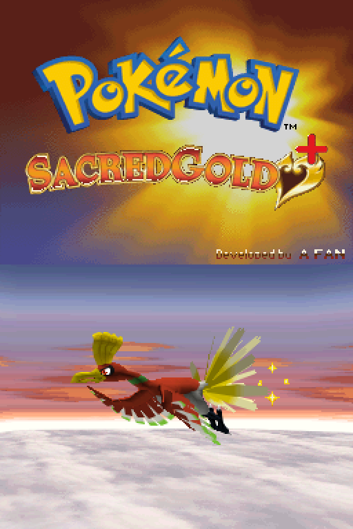
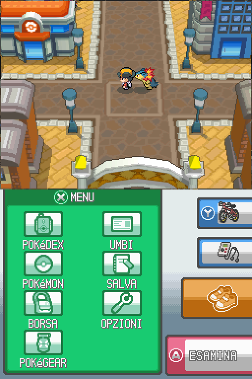
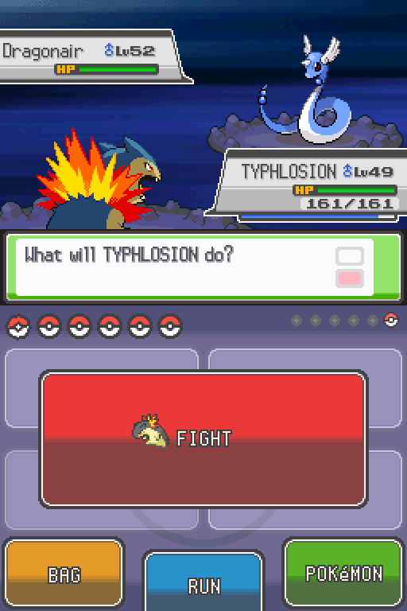
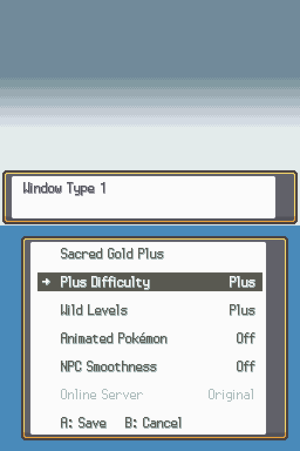
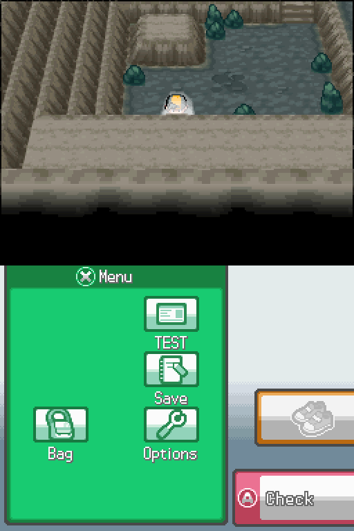
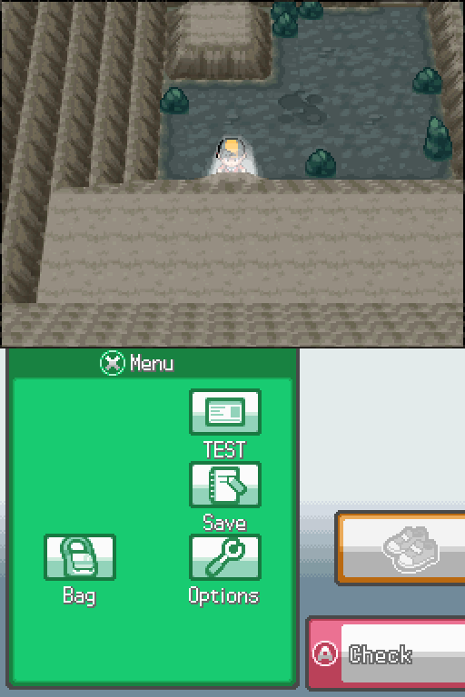
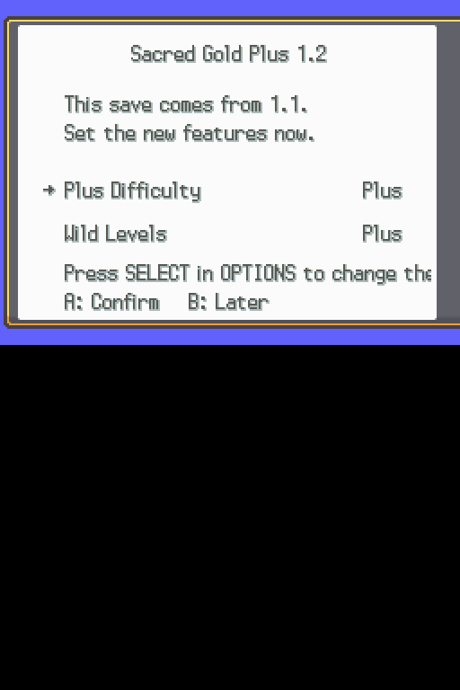

# Sacred Gold Plus

**A fan-made continuation of Sacred Gold Plus, for the Nintendo DS.**

**Version 1.2.4** · **License:** [GPL-3.0-or-later](LICENSE) (this project's own tools; third-party rights below)

Sacred Gold Plus adds Fairy typing, new Fairy moves and a wider camera option to Drayano's *Sacred Gold*. This continuation keeps that foundation and adds an Italian translation, a native indoor camera, adjustable difficulty, and a set of quality fixes.

Original project: [Sacred Gold Plus by NefariousnessNo3436](https://www.reddit.com/r/PokemonROMhacks/comments/1m69jrj/sacred_gold_plus_fairy_type_full_implementation/) — the author’s announcement, with its documentation and downloads.

This is a **patch**, not a ROM: you apply it to your own legally obtained game file. No game file is distributed here.

## Screenshots

| | |
| --- | --- |
|  Title screen |  Exploring Cherrygrove City |
|  A trainer battle with Plus difficulty on |  The Sacred Gold Plus options page |
|  Indoors before: the wide camera letterboxes the top screen |  Indoors after: the classic camera, restored natively |
|  The one-time prompt on Continue | |

## Main features

- **English and Italian editions**, with translated dialogue and menus.
- **Adjustable Plus difficulty:** optional trainer and wild Pokémon level scaling, configured from the Plus options page with SELECT.
- **Optional Pokémon motion in battle**, switchable in the game settings.
- **Classic HeartGold camera in 52 interior and cave maps**, with the wider Plus camera outdoors.
- **Expanded Bag:** 252 slots in the main pocket and consecutive Rare Candy use from the party menu.
- **Quality-of-life improvements:** an in-game EV/IV guide, Wi-Fi connection slot selection, text corrections and gameplay fixes.

## Download

Get the ZIP for your language from the [**1.2.4 release**](https://github.com/Umberto-DEV/sacred-gold-plus/releases/tag/v1.2.4):

| Language | File |
| --- | --- |
| Italian | `Sacred-Gold-Plus-1.2.4-IT.zip` |
| English | `Sacred-Gold-Plus-1.2.4-US.zip` |

Each ZIP contains all 19 supported patch routes, the recommended cheats, the unchanged original manuals and the updated installation guide for that language. Download the named player ZIP; GitHub’s automatic “Source code” archives contain developer sources.

## Requirements

- An unmodified **Pokémon HeartGold** ROM, US or Italian, **or** an existing **Sacred Gold Plus 1.01, 1.02, 1.03, 1.04, 1.1, 1.2.1, 1.2.2 or 1.2.3** ROM (any camera) — you must obtain this yourself.
- A DS patching tool: a desktop program, an Android app, or a browser page (all free; links are in the package guide).
- An emulator or a flashcart. The searchable picker and L+R toggle require [this fork’s melonDS Android 2.1.1](https://github.com/Umberto-DEV/melonDS-android/releases/tag/v2.1.1).

## Install

1. Back up your game file and your save.
2. Open the ZIP, pick the patch matching your current file from its `Patch` folder, and apply it with one of the supported tools.
3. Follow `HOW-TO-INSTALL.txt` (English) or `COME-INSTALLARE.txt` (Italian) inside the package for the full step-by-step guide.

## Compatibility

- **Saves:** existing 1.1/1.2/1.2.1/1.2.2 saves import. Extra Bag slots use a save extension; older ROMs do not expose those items, and saving there prevents automatic recovery of the extra slots. Keep a backup when changing ROM builds and load the normal in-game save.
- **Cheats:** the game header is unchanged from 1.2, but import the updated catalogue to get the corrected codes. 1.1 catalogues have a different header. Every supplied code starts disabled.

## Source code and contributing

Everything that builds and checks this game is in [`source/`](source/README.md): the library that rebuilds 1.2.4 from an unmodified HeartGold ROM with one command and verifies it with another, one folder per feature with our C sources, tools and tests, and the technical reference in [`source/docs/`](source/docs/). The only game file you need is the retail game you already own — the first build step derives our 1.1 base from it with a published patch of differences, so no intermediate ROM of ours is needed and none is distributed.

- The maintainer and coding assistants work **only on `main`, without creating branches or pull requests**, in every current and future chat or session. See the standing instructions in [AGENTS.md](AGENTS.md). Changes are reviewed and checked before publication; community contributions from other accounts may still use pull requests.
- Every push and pull request runs the tests that need no game file (`source/run_tests.py`). Building the game needs your own copy of it, so that step happens on your machine, never on GitHub; the pull request template asks what you ran locally.
- Finished versions are tags (`v1.2.4`) with the player ZIPs attached to the [release](https://github.com/Umberto-DEV/sacred-gold-plus/releases); previews are marked pre-release.
- Never commit ROMs, saves, BIOS, dumps, game text or extracted game data. The public-file check in CI refuses them.

## Credits

Built on **Drayano**'s *Sacred Gold* and Storm Silver; **mikelan / Mikelan98** contributed the Fairy-type implementation; **NefariousnessNo3436** created Sacred Gold Plus and its 1.03 additions, and [allowed reuse with credit](https://www.reddit.com/r/PokemonROMhacks/comments/1m69jrj/sacred_gold_plus_fairy_type_full_implementation/). This is an independent continuation, not an official handover. The original PDF guides in the packages remain credited to Drayano and the original contributors; **@JD48096761** compiled the trainer reference. Developed by a fan, with community contributions.

Third-party material used by the tools, none of it redistributed here: the character mapping from [pret/pokeheartgold](https://github.com/pret/pokeheartgold) (read from your own checkout), [ndspy](https://github.com/RoadrunnerWMC/ndspy), [Unicorn](https://www.unicorn-engine.org/) and [Capstone](https://www.capstone-engine.org/) as pinned dependencies, and the [melonDS](https://melonds.kuribo64.net/) core (GPL-3.0-or-later) as the base of the headless test bench you build yourself.

## License

This project's own tools and sources are licensed under [GPL-3.0-or-later](LICENSE). Pokémon, the original game and third-party contributions remain under their owners' rights; attribution does not transfer them. No game code, text, graphics, ROM, BIOS or save is distributed here.

---

## In italiano

**Sacred Gold Plus** è una continuazione amatoriale di Sacred Gold Plus per Nintendo DS: tipo Folletto, nuove mosse Folletto e camera panoramica, con in più traduzione italiana, camera originale negli interni, difficoltà regolabile e correzioni.

Progetto originale: [Sacred Gold Plus di NefariousnessNo3436](https://www.reddit.com/r/PokemonROMhacks/comments/1m69jrj/sacred_gold_plus_fairy_type_full_implementation/) — il post dell’autore con documentazione e download.

Questa è una **patch**, non una ROM: va applicata a una copia posseduta legalmente del gioco. Nessun file di gioco è distribuito qui.

**Funzioni principali:**

- **Edizioni italiana e inglese**, con dialoghi e menu tradotti.
- **Difficoltà Plus regolabile:** livelli di allenatori e Pokémon selvatici configurabili dalla pagina Plus, accessibile con SELECT.
- **Animazioni opzionali dei Pokémon in lotta**, attivabili dalle impostazioni del gioco.
- **Camera classica di HeartGold in 52 mappe di interni e grotte**, con camera panoramica Plus all’aperto.
- **Borsa espansa:** 252 slot nella tasca principale e uso consecutivo delle Caramelle Rare dal menu Squadra.
- **Migliorie pratiche:** guida EV/IV nel gioco, scelta dello slot Wi-Fi, correzioni dei testi e del gioco.

**Download:** dalla [release 1.2.4](https://github.com/Umberto-DEV/sacred-gold-plus/releases/tag/v1.2.4), `Sacred-Gold-Plus-1.2.4-IT.zip` o `Sacred-Gold-Plus-1.2.4-US.zip`. Ogni ZIP include tutte le 19 patch supportate, cheat consigliati, manuali originali intatti e guida di installazione aggiornata. Scarica questi pacchetti per giocare; gli archivi automatici “Source code” contengono i sorgenti per sviluppatori.

**Requisiti:** una delle 19 ROM identificate nel manifest: HeartGold originale USA/Italia oppure Plus 1.01, 1.02, 1.03, 1.04 (entrambe le camere e lingue), 1.1, 1.2.1, 1.2.2 (entrambe le edizioni) o 1.2.3; un programma di patching (guide nel pacchetto); il selettore con ricerca e L+R richiede melonDS Android 2.1.1 di questo progetto.

**Installazione:** (1) backup di gioco e salvataggio; (2) applica la patch giusta dalla cartella `Patch` con uno dei programmi supportati; (3) segui `COME-INSTALLARE.txt` nel pacchetto per la guida completa.

**Compatibilità:** i salvataggi esistenti vengono importati. Gli slot aggiuntivi della Borsa usano un’estensione del salvataggio: tornando a una ROM vecchia, gli oggetti negli slot extra non sono disponibili; salvando con quella ROM non si recuperano automaticamente al ritorno. Carica il salvataggio normale del gioco, non un savestate precedente. L’intestazione è invariata dalla 1.2, ma importa il catalogo aggiornato per le correzioni. Tutti i codici sono spenti di default.

**Per chi sviluppa:** i sorgenti, gli strumenti e i test stanno in [`source/`](source/README.md). Il manutentore e gli assistenti lavorano **solo su `main`, senza creare branch o pull request**, anche in tutte le chat future: la regola permanente è in [AGENTS.md](AGENTS.md). Le modifiche si verificano e si pubblicano direttamente lì; la ROM si costruisce sulla propria macchina, con il proprio file di gioco, mai su GitHub. L'unico ingresso è la **HeartGold originale** della propria lingua: il primo stadio della costruzione ne ricava la base 1.1 applicando una patch pubblica di sole differenze, quindi non serve nessuna ROM intermedia e nessuna ROM viene distribuita.

**Crediti:** basato su *Sacred Gold* di **Drayano**, continuazione di **Sacred Gold Plus** con credito alla community originale. Sviluppato da un appassionato, con contributi della community.

**Licenza:** strumenti di questo progetto sotto [GPL-3.0-or-later](LICENSE); Pokémon, il gioco originale e i contributi di terzi restano dei rispettivi proprietari — crediti completi in `LEGGIMI.txt` nel pacchetto.
