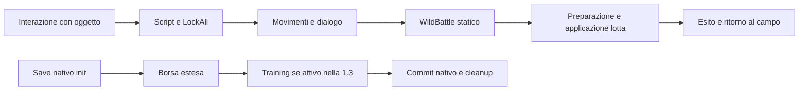

# Diagnosi di stabilità e prestazioni

Aggiornamento del 29 ottobre 2026: la successiva
[verifica funzionale Android](android-1.3-dev-validation.md) conclude la campagna
corrente con 49 checkpoint accettati. Pin, conteggi, risultati e limiti di questa
tappa precedente restano quelli documentati sotto.

Indagine del 28 ottobre 2026. La priorità è distinguere i freeze reali della
1.2.5 da regressioni nel successore privato 1.3. Il controllo statico ha già
prodotto un difetto riproducibile nell'ammissione del training 1.3. La successiva
riproduzione locale identifica il crash di Mew, riconosciuto dall'utente come
il proprio episodio; Latios resta da riprodurre. Il [piano eseguibile](deep-debug-2026-10-28-plan.md)
mantiene separati risultati, ipotesi e verifiche ancora necessarie.

## Aggiornamento sul caller del salvataggio

La successiva verifica del codice macchina EN/IT conferma un falso successo
della UI touch nel candidato 1.3. Con training già attivo e record Borsa
estraneo nella destinazione inattiva, il writer rifiuta correttamente il
salvataggio restituendo 3. Il gestore nativo ripristina il contatore e libera
il blocco sleep; `Field_SaveGameNormal` restituisce FALSE. Il caller della
schermata passa comunque al messaggio di salvataggio riuscito e al relativo suono.

La prova esegue in Unicorn i caller, il codice Borsa/training e il cleanup
nativo estratti dai candidati verificati, due tentativi per lingua. Lo stato RAM
è sintetico e le primitive flash/grafiche sono controllate: una lettura riuscita
fornisce il record estraneo; non avviene alcuna scrittura. Non è una prova di
guasto fisico dello storage, rendering della schermata o retry dell'utente.
Il controllo di successo usa un ritorno nativo 2 e verifica il caller, non
dimostra un commit flash completo.

La correzione è ora implementata in
[`save_ui.py`](../sgp13/save_ui.py) e nel relativo
[`helper nativo`](../features/save-ui/runtime.c), integrata nel builder e
verificata sui candidati EN/IT sotto identificati. Su FALSE compare
«Salvataggio non riuscito. I progressi non sono stati salvati.»; icona e
movimento vengono rilasciati una volta. Dopo il testo, il giocatore deve
rilasciare i comandi, premere A/B o toccare lo schermo, poi rilasciare di nuovo.
Il gioco torna al campo e consente di riaprire Salva. Il rifiuto rimane tale
finché la sua causa persiste; nessun dato estraneo viene cancellato.

Lo stato 9 della UI touch, usato per «non è il mio salvataggio», e il percorso
fatale nativo degli errori flash non sono riutilizzati. Il percorso TRUE mantiene
messaggio, suono e chiusura nativi. Non cambiano writer, formato del save,
identificatori o dati esistenti. L'estensione locale di overlay30 è di 224 byte
grezzi, con 1764 byte compressi nello slot originale di 2048; non consuma la
riserva residente. Questo costo è una correzione di affidabilità, non una
riduzione del carico del gioco.

### Verifica della UI e del commit

Il test sul dispatcher reale fallisce prima della modifica perché viene
richiesto il messaggio di successo dopo FALSE. Dopo la modifica passano dieci
test mirati senza skip: quattro Class A e sei Class B con sottocasi EN/IT,
controlli ABI, conferme A/B/touch, cancellazione, rifiuto ripetuto e mutazioni
del binario che devono essere respinte dalla verifica indipendente.

Una prova composta esegue i writer Borsa/training e il save manager nativo:
una discordanza simulata nel readback di una copia Borsa blocca il commit
nativo e provoca rollback. Rimuovendo soltanto quella discordanza, il tentativo
successivo scrive main e PC, passa da generazione 120/banco 0 a 121/banco 1 e
conserva inventario, impostazioni e corsi. I footer main/PC e i record estesi
hanno checksum e generazioni verificati indipendentemente. Questa è esecuzione
di codice macchina con primitive I/O controllate e un nuovo contesto app
modellato; la riapertura tramite input è provata separatamente sotto.
Il CRC del save è CCITT con inizializzazione
FFFF: la precedente seam Task4P usava il CRC IBM dell'header ROM e non provava
un commit riuscito. Il nuovo test corregge la seam e verifica il CRC sui dati
reali prima dell'esecuzione.

Nel banco melonDS sul Mac, ciascuna lingua parte da un raw con training
attivo; soltanto otto byte del record Borsa inattivo sono sostituiti con un
prefisso estraneo, su una copia. Il messaggio localizzato resta visibile per
600 frame senza input. Il touch della conferma, mantenuto premuto durante la
stampa, non lo chiude. A, B e touch nuovi, seguiti dal rilascio, tornano al campo;
tre riaperture effettive e due ulteriori rifiuti per lingua conservano l'SRAM
byte per byte. I dump della
coda VWait mostrano il task di distruzione dell'icona e la sua rimozione al
frame seguente, prima dell'uscita dall'app. Il task di movimento e quello
dell'icona in VBlank non rimangono pendenti.

### Compatibilità raw dei candidati integrati

Sono passati nove cicli reali Continue → SAVE dal menu → nuovo processo con
il raw appena scritto: sette casi legacy/configurati/Borsa estesa/avanzato
come nella matrice precedente, più due con training attivo, uno per lingua.
Non sono nove avventure indipendenti: i casi legacy EN/IT condividono lo stesso
input e alcune fixture derivano dallo stesso save. Nessun savestate sostituisce
questi cicli. Tutti gli originali conservano l'hash.

Nei sette casi precedenti sono confrontati nove gruppi di dati, inclusi
progressione, squadra, tutti i box, inventario e impostazioni. Nei due casi
attivi sono preservati i due Pokémon depositati, identità e obiettivi dei corsi,
portafoglio, oggetti e impostazioni; il tempo di gioco accreditato avanza
legittimamente. Il commit seleziona banco 1/generazione 121, con checksum nativi
ed estesi validi. In tutti i nove casi l'SRAM riesportata dopo il cold boot
coincide con quella salvata. I 22 controlli di vitalità delle sessioni sono
positivi, accompagnati dagli oracoli di stato e dati: il solo exit 0 non basta.

| Candidato privato Task 4, integrato | SHA-256 |
| --- | --- |
| EN | `9c577ae4f4d51fbbedd19bee7f65610ad4c93c04815923161752c0b8549b1031` |
| IT | `46422b8c3e97eec7c7eb7718ec1c6c6b7ffc49e79b1783435d04b89ae506f609` |

Le due build includono anche il lavoro concorrente su Guida, Plus e learnset.
Le impronte dei 176 file censiti dal builder sono conservate con una copia
privata degli input; questa non include implicitamente tutti gli strumenti
esterni. Le verifiche finali confermano overlay30, metadati e bank40 dopo gli
stadi successivi. La suite generale di quello snapshot esegue 654 test con
successo e ne salta 204; i dieci test mirati sopra sono eseguiti separatamente
con gli input privati. Non si sommano i conteggi come casi tutti distinti.

Restano fuori da questa accettazione il retry transitorio fino al successo
nell'emulatore completo, guasti fisici o interruzioni di alimentazione,
nuove azioni di pagamento/premi, verifica audio percettiva e dispositivo Android.
La copertura dimostra i casi descritti, non compatibilità universale o assenza
di ogni errore di salvataggio. La 1.2.5 pubblicata rimane invariata.

## Requisiti

Ridurre input lag, scatti, instabilità e lavoro imposto all'emulatore mantenendo
le stesse funzioni e velocità di gioco. Migliorare la sicurezza dei salvataggi
senza perdere progressione, Pokémon, inventario esteso o impostazioni esistenti.
L'utente chiede un censimento, flussi fra categorie, ricerca di problemi noti,
analisi statica prima dei test d'interazione e approfondimento dei singoli
elementi sospetti. L'approfondimento segue le prove, non il numero di file letti.

Segnalazioni: 1.2.5 su un dispositivo Android. Mew: movimento libero nel Bosco Smeraldo,
pressione di A davanti al Pokémon, poi immagine ferma e suono bloccato
sull'ultima nota. Latios: totem di Aranciopoli, animazione prelotta completata,
poi freeze sulla schermata bianca prima della comparsa dei Pokémon, con lo
stesso sintomo audio. Sono due punti diversi del flusso, non la prova di una
causa comune. Lo stato macchina dell'episodio originale sul dispositivo non è
disponibile; Mew dispone ora di una riproduzione locale con dump e registri.
Un precedente resoconto del 24 ottobre descriveva Latios
bloccato dopo ingresso in lotta e una successiva cattura riuscita con candidato
personalizzato: vedere [manutenzione](../features/manutenzione/README.md).
Quella prova non stabilisce la causa né invalida il nuovo resoconto.

## Censimento delle responsabilità

Questa ROM non è un'applicazione con un database remoto. La persistenza usa
array nativi nel save, blocchi Plus e journal; i contenuti risiedono in archivi
NARC e tabelle della ROM. Python costruisce/verifica la patch; durante il gioco
girano ARM9/ARM7, overlay e codice Thumb residente.

| Categoria | Ingressi e consumatori | Stato e rischio da seguire |
| --- | --- | --- |
| Build e identità | `sgp12/costruisci.py`, 19 stadi; `sgp13/build.py`, espansione e nuovi servizi | Preimmagini, dimensioni, ABI, overlap; una compilazione riuscita non prova gameplay |
| Campo, eventi e caricamenti | `features/camera`, `npc`, script NARC, motore movimenti | Oggetti/follower, LockAll, WaitMovement, task e overlay |
| Lotta e regole Plus | `native-core`, hook party/wild, `trainer-strategy` | Generazione della squadra, dati temporanei e differenza incontri casuali/statici |
| Animazioni e menu lotta | `anim2`, `manutenzione`, `borsa-lotta`, `squadra-lotta` | Proprietà copie OAM, durata BattleContext, riuso dati già residenti |
| UI e consultazione | `options`, `plus-ui`, `field-guide`, `native-eviv` | Input, callback, finestre, cache font e ripristino del proprietario |
| Inventario | `borsa`, `caramelle`, `capacita-borsa` | Vista nativa/runtime, 108 slot aggiuntivi, limiti e sincronizzazione |
| Persistenza | `plus-chunk`, Borsa, `training-native`, save manager nativo | Generazione/CRC, proprietà dei settori, ordine commit e gestione degli errori |
| Prove | `run_tests.py`, Unicorn, `runtime`, `verifiche` | Skip espliciti, seam simulate, oracolo dello stato raggiunto |

Il design system nativo è già descritto nel [contratto HGSS](hgss-ui-contract.md):
due schermi 256×192, griglia 8px, font e palette nativi, controlli touch e tasti.
Impeccable serve qui per leggere coerenza, feedback e costi del rendering; metriche
web, nuovi font o ridisegno delle schermate non rispondono al problema segnalato.
La Guida già disegna al cambio di stato e possiede una cache font delimitata
all'apertura; le cache Borsa/Squadra riusano BattleContext. Non si propone un'altra
cache prima di avere misurato un costo residuo e la sua invalidazione.

## Flussi che meritano approfondimento

Mew: script membro 115, quattro interazioni; il quarto incontro arriva a
`WildBattle(151,45,0)`. Latios/Latias: membro 776,
`WildBattle(381/380,40,0)`. I parametri sono validi in EN e IT.
Il percorso statico usa `SetupAndStartWildBattle` e
`FieldSystem_GenerateSingleWildPokemon`; il solo hook Plus per incontri casuali
non basta a spiegare un freeze in questo percorso.

Un callback può attendere indefinitamente anche mentre l'emulatore presenta
frame regolarmente. La maschera nativa di LockAll a `0x021D415C` distingue player,
oggetto parlato, follower e partner. Il probe ARM EN/IT mantiene una reale attesa
per 120 chiamate con il movimento dell'oggetto pendente; togliendo solo quel bit,
il callback completa. È una prova del discriminante diagnostico, non una
riproduzione del difetto utente. Non autorizza ad azzerare la maschera nel gioco.
Il suono fermo sull'ultima nota richiede anche PC ARM9/ARM7, progresso vblank,
stato interrupt e task di caricamento: una normale attesa di LockAll non spiega
da sola tutti i sintomi. La testimonianza online con musica che continua non
va trattata come identica a questa segnalazione.

La raccolta successiva ha tre punti, in ordine:

1. Contatore del main loop `0x021D1138`, progresso VBlank osservato separatamente,
   PC ripetuti delle due CPU e interrupt: distinguere
   l'esecuzione bloccata da una callback che continua a essere richiamata.
   Un singolo PC in HALT non dimostra un crash.
2. Catena completa dei task e contesto script: il padre può già essere passato
   allo stato successivo mentre attende il figlio. Per Latios seguire transizione
   e BGM, `CallTask_LeaveOverworld`, `CallTask_StartBattle`, quindi
   `Battle_LaunchApp` e `FieldSystem_ApplicationIsRunning`.
3. Solo nel confine individuato, ingresso/uscita del loader overlay, risultato
   dell'allocatore e primo `GF_AssertFail`: separare I/O, heap e percorso errore.
   Il comportamento degli assert dipende dallo stato runtime, ancora sconosciuto.

I flag alti ereditati dall'hack restano un rischio distinto: la manutenzione
documenta accessi oltre SaveVarsFlags nel PalPad. Una rimappatura senza censimento
e migrazione potrebbe rompere salvataggi esistenti; non è una correzione ammessa
sulla sola correlazione con gli eventi leggendari.

Il confronto binario EN/IT fra Classic 1.04, Plus 1.1, 1.2.3, 1.2.4 e 1.2.5
trova identici i due script, gli eventi 143/51 e il codice di LockAll e del suo
callback. Questo esclude modifiche dirette a quelle regioni nelle ultime due
release; non esclude interazioni con altri hook o differenze dello stato runtime.
Le quattro fasi di Mew vanno quindi distinte dal caso Latios prima della comparsa dei Pokémon,
senza assumere una causa comune.

## Crash Mew riprodotto e causa dimostrata

La ROM pubblicata 1.2.5 IT è stata avviata con una copia del save avanzato,
preparando l'arrivo davanti al primo Mew con il cambio mappa nativo. Il campo
risulta stabile prima dell'interazione. Il flag di visibilità era già libero:
non viene modificato. La sola preparazione specifica è la destinazione del
warp, mappa 147, player in 22,54 rivolto verso Mew in 22,53. Le pressioni di A
sono input normali; nessun salto diretto allo script o alla lotta.

Il primo A raggiunge il verso e il messaggio «Myuu!». Dopo il secondo A,
lo script fa sparire il primo Mew e avvia il movimento del successivo.
Due esecuzioni identiche entrano nel loop di abort al frame del banco 5315.
Il contatore del main loop rimane a 4856, ARM9 resta a `0xFFFF0108` per 647
campioni e il player non risponde ai comandi. Il controllo con identico setup
senza interazione supera 1200 frame, continua ad aggiornarsi e accetta i movimenti.
L'utente conferma che questo è il blocco di Mew segnalato.

La causa è una violazione della durata del contesto dello script:

1. Lo script 3 avvia il movimento d'ingresso dell'oggetto 13 e termina senza
   attenderlo. Lo stesso ordine compare nei due successivi trasferimenti.
2. Il worker `_RunObjectEventMovement` resta nella coda principale con movimento
   pendente e `FieldSystem.taskman=0`, perché il task dello script è già distrutto.
3. Il worker chiama `FieldSysGetAttrAddr`, che invoca
   `TaskManager_GetEnvironment(NULL)`. I registri ARM9 riportano `r0=0`,
   `CPSR=0x97` (abort) e `LR=0x02050658`: la lettura che fallisce è
   `ldr r0,[r0,#0xC]` a `0x02050650`, coerente con LR meno 8.

Non è quindi un'attesa infinita di LockAll. Il contesto liberato contiene anche
gli script di movimento referenziati dal worker: mantenere vivo lo script fino
alla conclusione del movimento risolve il problema alla sorgente.

La controprova privata inserisce una sola `WaitMovement` dopo l'avvio del Mew
successivo. Conserva flag, messaggi, movimenti e destinazioni relative, aggiornando
soltanto gli offset necessari. ARM9/ARM7 e gli altri file e membri NARC restano
identici. Sulla medesima timeline le immagini precedenti al difetto coincidono;
il movimento conclude, il task termina e i comandi tornano a spostare il player.
Non viene sostituito il crash con una nuova attesa infinita.

L'implementazione in `sgp13/mew.py` riguarda i tre trasferimenti del membro 115,
nelle sole build future 1.3. Verifica l'hash completo del membro originale e dei
metadati del decoder, inserisce tre attese e ricalcola gli offset una sola volta.
Il membro cresce da 708 a 714 byte; flag, argomenti non relativi e sequenze di
movimento restano identici. Le altre risorse e gli eseguibili non vengono
modificati dallo stadio Mew. La rilettura verifica anche questi confini.

I nove nuovi test ROM-free verificano rilocazioni, input malformati, preimmagini
estranee e provenienza del decoder. Tre test Class B sulle ROM private EN/IT
controllano i tre percorsi effettivi: l'originale termina con movimento pendente,
il corretto attende, e sostituendo ciascuna nuova attesa con Nop il relativo
percorso fallisce di nuovo. Questa prova del flusso è simbolica; la prova del
crash nativo e del recupero proviene dall'emulatore, non da attese simulate.

La revisione indipendente non trova problemi bloccanti; conferma anche che
nessun salto o entry originale raggiunge direttamente il punto di inserzione
saltando l'attesa. La suite completa esegue 596 Class A e 4 Class B con successo:
600 eseguiti, 198 skip. I tre test Mew Class B sono stati inoltre eseguiti con le
fixture, senza skip. I candidati EN/IT hanno 164 impronte sorgente coerenti e
composizione riletta dal coordinatore:

| Candidato privato con training e Mew corretti | SHA-256 |
| --- | --- |
| EN | `6bd84a67db6478c390d949a8e08358fcc4fb4c64626cee33d9fc7b85c9cfc17b` |
| IT | `83f8129d4037254eeae357ee647b3590fdc4f2e28df1099cf8f47529aefe9d24` |

La campagna runtime successiva usa copie della stessa fixture raw avanzata IT
su entrambe le build. Le interazioni sono pressioni reali di A; gli spostamenti
fra le posizioni usano riposizionamento nativo controllato del player, senza
modificare oggetti, script o avanzamento dell'evento.

| Gate Mew sul candidato | EN | IT |
| --- | --- | --- |
| Tre fughe, script 3/4/5: movimento completato e task terminato | Passa | Passa |
| Quarta interazione: lotta con Mew livello 45 | Passa | Passa |
| Fuga dalla lotta: esito nativo 5 e ritorno al campo senza task residui | Passa | Passa |
| SAVE dal menu dopo la terza fuga e Continue in un nuovo processo da raw | Passa | Passa |
| Stato dell'evento persistito, campo visibile e movimento dopo Continue | Passa | Passa |
| SRAM riesportata dopo Continue identica a quella salvata | Passa | Passa |

I due cold restart non usano savestate né scritture RAM: solo il raw salvato
dal gioco. Rimane il quarto Mew nella posizione prevista e il player si muove
da 41,63 a 41,64 con un input normale. Il confronto separato dei dump prima e
dopo il riavvio conserva profilo/opzioni/monete, squadra, Borsa nativa ed estesa,
variabili/flag, Pokédex, Day Care, Pokémon nei box e impostazioni Plus. La fixture
originale rimane identica. Questa è copertura di un save avanzato nelle due
lingue; non una nuova matrice universale di salvataggi.

Limiti del setup: alcuni salti diagnostici lasciano terreno non caricato o
collocano il player fra elementi della foresta. Quelle immagini non vengono
usate come prova grafica o di navigazione normale; il ritorno dal quarto incontro
prova esito e chiusura dei task, non il posizionamento artificiale del player.
La prova visiva e di movimento valida è il cold restart intermedio, con campo
ricostruito correttamente in entrambe le lingue. Le istantanee diagnostiche
sono state riaperte esclusivamente con la stessa ROM che le ha prodotte.
Cattura, KO, audio e dispositivo Android non sono coperti da questa campagna.

Un ulteriore controllo negativo usa una ROM privata con la sola prima attesa:
il primo evento passa, ma il secondo riproduce l'abort con il movimento del
terzo Mew pendente. Questo discrimina la necessità di correggere anche gli
altri trasferimenti. Nessun file di release 1.2.5 è stato sostituito.

## Primo tentativo locale sul totem Latios

Il totem di Aranciopoli è stato ricreato sulla ROM pubblicata 1.2.5 IT con la
stessa fixture avanzata: cambio mappa nativo, player davanti al totem e input
normali per dialoghi e scelta Sì. Cuorugiada era già presente e il flag di
visibilità già libero, quindi nessuna modifica manuale a Borsa o flag.
La prova attraversa la transizione bianca e raggiunge la schermata di lotta
con Latios livello 40; il movimento d'ingresso è concluso e lo script attende
normalmente il termine della battaglia. La continuazione diagnostica usa uno
snapshot creato dalla stessa ROM, senza trasferire stati fra versioni.

Il freeze Latios non è riprodotto da questa prova. Non è una soluzione e non
esclude un difetto dipendente da altri stati del save o dalla configurazione
del dispositivo. Non viene applicata a Latios la correzione di Mew. Il salvataggio
più recente e la configurazione Android rimangono utili per restringere il caso.

## Difetto dimostrato nella composizione dei salvataggi 1.3

`training_script(op=1)` ammette il servizio dopo `storage_ready()`, che verifica
soltanto i settori training 49/113. Il writer della Borsa può rifiutare dati
estranei non uniformi nei settori 48/112. Il successivo `training_save` richiede
che quel writer abbia completato entrambe le copie; restituisce 3 prima del
commit nativo se non è così. Tornare alla politica Legacy non spegne il journal.

Controprova: con training inizialmente inattivo, rendere estraneo uno dei quattro
record Borsa. L'attivazione ritorna successo, ma il save composto non raggiunge
il commit. Cambiare soltanto quel record sintetico in cancellato consente il
salvataggio. La prova usa i due blob ARM di produzione, senza ROM o `.sav`.
Il candidato V8 EN/IT, verificato uguale al runtime compilato prima della correzione, conferma
il difetto in entrambi i banchi; il cleanup nativo ripristina generazione e banca,
mantiene la flash e bilancia il blocco del sonno. Non è una corruzione del save
esistente, ma impedisce di salvare il progresso successivo all'attivazione.

La correzione implementata verifica anche i quattro record Borsa prima di attivare
training. Il journal attivo conserva la protezione contro commit parziali.
Il costo aggiunto è di al massimo quattro letture, per un totale di 1808 byte, quando si
richiede attivazione/cambio politica; non viene eseguito a ogni frame. Il buffer
allineato da 452 byte viene riusato per le verifiche training. Il codice residente
passa da 10572 a 10860 byte, dentro il limite di 11776: questa è una correzione
di sicurezza del salvataggio, non una riduzione del carico di rendering.
Resta distinta la comunicazione degli errori: il [contratto save](contracts.md)
documenta un caller tattile che ignora il risultato. Il riferimento nativo
[`TouchSaveApp_SaveGame`](https://github.com/pret/pokeheartgold/blob/0985e8718df4f25e64d6507d89c0c97c0d288981/src/touch_save_app.c#L460)
chiama `Field_SaveGameNormal` e passa comunque a PRINT_SAVED_MESSAGE; il wrapper
converte correttamente il risultato nativo in booleano, che il caller scarta.
La correzione del caller e le successive prove sul codice macchina, sulla
schermata e sulla riapertura di Salva sono descritte nell'apertura di questo
rapporto, con i limiti del retry transitorio e dei guasti fisici.

## Baseline e significato delle misure

Baseline fresca con Apple clang 21 e compilatore obbligatorio: Class A 633 casi,
581 eseguiti con successo e 52 saltati; Class B avviate dallo stesso runner:
147 casi, 4 eseguiti con successo e 143 saltati. Totale 585 eseguiti, 195 skip,
zero failure, 13,766 secondi. Gli skip non costituiscono copertura.

Il tempo host del banco include emulazione, CSV, watch e audio. Il contatore
RunFrame, gli FPS della superficie Android e il vblank del gioco misurano cose
diverse. `rileva_crash.py` controlla la coda finale; uno STALLO a PC variabile è
inconclusivo anche con exit 0. Per ogni percorso serve quindi un oracolo di
progresso: dialogo raggiunto, comando lotta accettato, ritorno al campo oppure
salvataggio ricaricato. Non sono ancora misurati miglioramenti di FPS, input lag
o caricamenti attribuibili a questa indagine.

## Verifica della correzione

Il test di regressione pubblico
[`test_save_composition.py`](../features/training-native/test/test_save_composition.py)
è fallito prima della modifica in tutte le otto combinazioni indirizzo/banco
del caso estraneo. Dopo la modifica passano sei test composti con dati sintetici,
compilando ed eseguendo entrambi i blob ARM di produzione. Il criterio di
ammissione è confrontato con le funzioni Borsa reali, inclusi 1356 casi di
mutazione dei prefissi; il test Python non replica la loro implementazione.

La suite del Task 1, prima della correzione Mew, con compilatore obbligatorio esegue 587 Class A con successo
(52 skip), più 4 Class B (143 skip): 591 eseguiti e 195 saltati. Separatamente,
i test nativi training sul candidato eseguono 25 casi EN e 25 IT, senza skip.
Le seam flash/OS/commit di queste prove ARM restano esplicite: non sono
equivalenti a un salvataggio nell'emulatore.

Sono stati quindi eseguiti sette cicli completi con melonDS headless, ciascuno
con baseline 1.2.5, Continue nel candidato, SAVE dal menu e nuovo processo per
il riavvio a freddo:

| Fixture | EN | IT |
| --- | --- | --- |
| Save precedente senza Plus | Passa | Passa |
| Impostazioni Plus presenti | Passa | Passa |
| Borsa estesa con contenuto | Passa | Passa |
| Progressione avanzata | Non eseguito | Passa |

Profilo/opzioni/monete, squadra, variabili/flag, Pokédex, Day Care, Pokémon nei
box, Borsa nativa/estesa e impostazioni Plus sono confrontati nei punti caricati,
salvati e riavviati. Le sette fixture originali conservano l'impronta; l'SRAM
riesportata dopo il cold boot coincide con quella appena salvata. Le 21 tracce
di queste sessioni risultano VIVO, con controllo separato dei dati e immagini
EN/IT dopo SAVE. Questo campione riguarda training inattivo: non certifica
corsi/pagamenti attivi, tutte le avventure o il dispositivo Android.

| Candidato privato Task 1, precedente alla correzione Mew | SHA-256 |
| --- | --- |
| EN | `f18ccb0a3899b993edc53575bef185093f08c7653227c0a73ccaab5cd583d106` |
| IT | `5dc3d7db53c98c9ba5c85b0707eac0c81420b86c1da2ec447fd580ef27f926be` |

Le due build hanno composizione e sorgenti riletti e verificati dopo la campagna.
La revisione indipendente Astra del Task 1 approva specifica e qualità senza
rilievi. Sono candidati di sviluppo privati: la 1.2.5 pubblicata non cambia.

## Primo controllo locale di cadenza e input

La disponibilità del dispositivo Android non è un prerequisito per preparare
scene, riprodurre eventi e misurare il lavoro del gioco nel banco locale.
L'utente autorizza il setup su copie del save disponibile. La conferma sul
dispositivo rimane una prova distinta, necessaria per il comportamento della
configurazione Android e per l'identità degli episodi segnalati.

Sulla ROM 1.2.5 IT sono state preparate due scene tramite la funzione nativa di
cambio mappa: Fiordoropoli (76) e Fiorpescopoli (67), usando una copia del save
avanzato. Dopo il controllo di campo stabile, ogni scena è conservata in uno
snapshot della stessa ROM. Le finestre misurate non contengono cheat, scritture
RAM o polling del debugger. Questi snapshot non sostituiscono le prove raw-save.

Per ogni città sono stati eseguiti sei offset iniziali consecutivi, da 90 a 95
frame, seguiti da 48 frame con GIÙ premuto e 60 di rilascio. Sono sei offset di
uno stesso stato per città e due fasi effettive del ciclo, non sei stati
indipendenti. Il percorso termina sei
caselle a sud della partenza e conserva mappa, campo attivo e assenza di task
o pause. Le immagini iniziali/finali sono state controllate e l'SRAM esportata
coincide con quella di ingresso. Gli originali conservano l'impronta.

| Misura nel campione | Fiordoropoli | Fiorpescopoli |
| --- | --- | --- |
| Intervallo tra iterazioni osservate del main loop | Sempre 2 frame hardware emulati | Sempre 2 frame hardware emulati |
| Frame completati dalla pressione alla prima osservazione del polling input | 1–2 | 1–2 |
| Frame completati dalla pressione alla prima variazione della posizione continua | 2–3 | 2–3 |

L'asse temporale è il numero di `RunFrame` del banco, tutti da 263 scanline;
`tracepc on` abilita il conteggio delle visite al ciclo principale. La pressione
è verificata nel bit GIÙ di `keymask`, il polling in `gSystem.heldKeysRaw` e la
risposta nelle coordinate continue dell'oggetto player. I campioni sono presi
a fine frame: non forniscono latenza subframe o risposta visiva del display.
Il contatore chiamato `game_vblank_counter` dal banco cresce nel main loop dopo
le attese e non è un conteggio diretto degli interrupt; `game_frame_counter`
viene invece azzerato dal main loop. Nessuno dei due da solo misura gli FPS.

Un primo percorso andata/ritorno entrava in un edificio: i suoi intervalli
aggregati sono esclusi dal confronto delle città. Il percorso corretto procede
in una sola direzione e verifica la permanenza nella mappa a ogni campione.
La revisione indipendente conferma che il contatore del main loop aumenta solo
di zero o uno per campione, senza aggiornamenti multipli nascosti.

Risultato limitato: nessuna differenza nelle metriche guest di questi due brevi
tratti. Non sono ancora misure del percorso che rallenta per l'utente, un
confronto prima/dopo, una prova di fluidità delle città intere o una misura
controller-display. Nessun miglioramento di prestazioni viene attribuito alla
correzione training.

## Costo inclusivo del controllo campo

Un successivo esperimento privato osserva `FieldSystem_Control` dall'ingresso
Thumb al ritorno nel caller, controllando PC, stack e modalità CPU. La misura
include i callee, gli interrupt e le attese nel periodo osservato: non è il
costo esclusivo della funzione. Conta visite al dispatcher ARM9, comprese le
istruzioni condizionali non eseguite, e cicli emulati trascorsi; nessun tempo
host o FPS del dispositivo.

Il banco è stato prima validato con casi sintetici di conteggio, confini,
ritorno e drain, e 29 test del verificatore. Poi sono stati eseguiti una sola
volta due processi sullo stesso snapshot 1.2.5 IT di Fiordoropoli: 90 frame
neutri, 48 con GIÙ oppure input neutro, 60 neutri per completare le chiamate.
Ogni caso contiene 24 chiamate complete, senza errori dell'osservatore,
rientri o chiamate pendenti. Scena, input, preimmagini e SRAM superano i
controlli; il cammino termina sei caselle a sud, il controllo resta fermo.

| Misura, 24 chiamate per caso | Cammino | Input neutro |
| --- | ---: | ---: |
| Cicli ARM9 emulati trascorsi, totale | 4 126 732 | 4 831 709 |
| Visite al dispatcher, totale | 2 352 769 | 2 819 978 |
| Cicli emulati per chiamata, minimo–massimo | 102 813–493 332 | 201 242–202 001 |
| Chiamate che attraversano un confine di frame hardware | 6 | 0 |

Il totale minore durante il cammino non è un guadagno: le due azioni sono
diverse e la ROM è identica. I sei picchi richiedono attribuzione fra lavoro
sincrono e interrupt; attraversare un frame non dimostra di per sé un
aggiornamento perso. Non è ancora identificato un costo dominante della città.
Un eventuale sottointervallo su `FieldInput_Process` può localizzare i picchi
nel flusso, ma deve distinguere il lavoro degli interrupt prima di attribuirli
alla funzione. Nessuna ottimizzazione è stata applicata con questo esperimento.

## Fonti e applicabilità

- [Drayano, thread originale Sacred Gold](https://gbatemp.net/threads/pokemon-sacred-gold-storm-silver.327567/): elenca problemi Mew su alcune flashcard e Steven ad Aranciopoli su R4. Stabilisce precedenti nell'hack, non la causa nella 1.2.5.
- [Segnalazioni dirette nel thread, pagina 114](https://gbatemp.net/threads/pokemon-sacred-gold-storm-silver.327567/page-114): episodio Mew su melonDS 1.1 con audio attivo e input fermo. Testimonianza su altra versione, da usare per scegliere osservazioni.
- [Tracker del progetto](https://github.com/Umberto-DEV/sacred-gold-plus/issues): la consultazione API del 28 ottobre trova due issue chiuse, numero versione e tipi di mosse; nessuna delle due documenta i freeze segnalati. La pagina web indicizzata era meno aggiornata.
- [melonDS Android](https://github.com/rafaelvcaetano/melonDS-android): core/frontend, JIT e renderer sono variabili separate. Il package del dispositivo osservato storicamente è una build personalizzata; non si presume equivalenza con una versione upstream attuale.
- [Perfetto: system tracing](https://perfetto.dev/docs/getting-started/system-tracing) e [libreria input](https://perfetto.dev/docs/analysis/stdlib-docs): schedulazione, input e correlazione con frame presentati; ACK non equivale a risposta visibile del gioco.
- [Perfetto FrameTimeline](https://github.com/google/perfetto/blob/main/docs/data-sources/frametimeline.md): la documentazione segnala limiti sulle SurfaceView. Verificare tracce disponibili per il renderer reale; una superficie regolare può avere latenza elevata.
- [pret/pokeheartgold](https://github.com/pret/pokeheartgold/tree/0985e8718df4f25e64d6507d89c0c97c0d288981): riferimento nativo fissato, verificato contro i binari EN/IT. Implementazioni di altre generazioni non vengono trasferite come se avessero la stessa ABI.

REA è stato consultato come metodo di identità, provenienza e distinzione fra
inferenze e osservazioni. La diagnostica locale trova registrazione non pronta,
runtime Node non supportato dalla CLI corrente e nessun motore nativo configurato.
Non è stata eseguita decompilazione REA. Le prove effettive usano gli strumenti
ARM e il disassemblato già disponibili, senza modificare configurazioni globali.

## Limiti e risultato da raggiungere

Non è stata acquisita una fixture raw del dispositivo esattamente precedente ai
due freeze. La fixture derivata ha però riprodotto Mew, con controllo negativo,
registri di eccezione, controprova e riconoscimento dell'utente. Latios resta aperto.
Nella prima fase il dispositivo non era disponibile; la successiva acquisizione
descritta sotto conserva la configurazione attuale, ma non una nuova cattura
del blocco. La release 1.2.5 resta invariata;
il difetto training riguarda esclusivamente il successore 1.3 privato.

## Acquisizione Android e laboratorio Mac

La sessione successiva del 28 ottobre acquisisce l'ambiente realmente usato:
melonDS 2.1.4 PROFILING, Android 13/API 33 ARM64, pagine 4 KiB, JIT attivo,
renderer compute con scala interna 6x, rendering su thread e doppio display.
APK, firma e librerie native, ROM, raw, BIOS, configurazione esportata, mapping
controller e cinque codici cheat selezionati sono identificati nel pacchetto
privato. L'export delle preferenze non include il database cheat o le concessioni
SAF: selezioni e codici sono verificati attraverso l'interfaccia. La ROM
personale differisce dalla 1.2.5 IT canonica per sei byte di statistiche;
eseguibili e script confrontati coincidono. Questo non attribuisce una causa
ai freeze. La firma dell'APK non prova la corrispondenza con un checkout locale.

Il raw originale è preservato. Una copia portata a Fiordoropoli tramite warp
nativo, SAVE e Continue a freddo nel banco Mac viene avviata sul dispositivo Android. Una
sequenza direzionale limitata, con rilascio neutro, verifica la risposta del
campo; un video separato conserva il percorso. La copia viene poi salvata dal
menu del gioco e ricaricata dopo chiusura completa del processo Android;
campo visibile e risposta alla direzione sono osservati. Non si usa un
savestate. È una prova su una fixture IT derivata, non una certificazione di
tutti i salvataggi o del candidato 1.3.

Il raw scritto sul dispositivo viene inoltre ricaricato in un nuovo processo
del banco Mac: stessa mappa, posizione e contatore, campo attivo e ri-esportazione
byte per byte identica. Checksum dei banchi nativi e dei record estesi validi;
squadra, box, Pokédex, inventari e impostazioni confrontati risultano preservati.
Tempo di gioco, posizione, RTC e contatori di passi cambiano come registrato
nel rapporto privato. Questa verifica usa interprete/software con RTC fisso:
prova il trasferimento del raw, non l'equivalenza Android o grafica.

| Osservazione | Risultato e confine |
| --- | --- |
| Fiordoropoli, personaggio fermo | Tre finestre di circa 30 s: mediana 11,87 CPU-s del processo, intervallo osservato 11,67–11,92. Scala equivalente a un core, circa 39,5%; non capacità totale né margine disponibile |
| Sala Koga, personaggio fermo | Due finestre valide: 9,97 e 10,08 CPU-s. Una pausa valida: 2,33 CPU-s. Scene diverse, nessuna ottimizzazione prima/dopo |
| Controllo SurfaceFlinger | Circa 60 presentazioni/s anche in pausa: il conteggio non rappresenta i frame del gioco. Il valore 62,5 ricavato dal bucket intero di 16 ms non è un framerate esatto |
| Perfetto | Trace decodificabili con FrameTimeline globale, ma nessun payload scheduler/ftrace/process stats richiesto e nessuna attribuzione CPU al processo. Assenza di dati, non CPU nulla |
| FPS e input | Immagini finali mostrano 60; non sono una serie temporale. ACK Android del comando direzionale non misura latenza fisica o momento di accettazione guest |

L'analisi CPU ricalcola dai raw con identità PID/starttime, tick effettivi,
controllo stderr e margini di quantizzazione; margini non statistici. Due
corse potenzialmente contaminate da cambio pausa/sovrapposizione sono escluse
e conservate. Il maggiore lavoro CPU nella città rispetto alla sala non
localizza il collo di bottiglia. Alimentazione in carica, overlay temporaneo,
frequenze puntuali e Thermal HAL non pronto limitano l'interpretazione.
Nessuna assenza di scatti o eliminazione dell'input lag è dimostrata.

Al termine i 14 file sorgente ricontrollati hanno hash invariato. Contatore
FPS e spegnimento automatico sono ripristinati; le copie temporanee di ROM/raw,
tracce, video e helper sul dispositivo sono rimosse dopo verifica delle copie
locali. La cartella di esportazione delle preferenze resta disponibile. Dati
personali, binari e tracce restano esclusi dalla pubblicazione.

L'AVD Android 13 ARM64 dedicato si avvia dopo il recupero di spazio gestito
separatamente: i primi due tentativi erano stati fermati dal controllo userdata.
L'APK installato ha lo stesso SHA-256 di quello acquisito. API 33, ABI ARM64 e
pagine 4 KiB coincidono; GPU, driver e display differiscono. Preferenze importate
tramite UI, cartelle SAF riconcesse, BIOS e raw copiati e verificati. Il catalogo
di laboratorio contiene i cinque codici selezionati, confrontati integralmente
con l'XML acquisito; non riproduce l'intero database privato dell'app.

Il lancio con la preferenza Compute 6x importata fallisce su GLES 3.0:
il log registra un errore di compilazione del vertex shader del compositore
(`unsupported shader version`, `#version 320 es`), seguito nello stesso processo
da uscita `SIGNALED`, stato 11. L'interfaccia nasconde il selettore del renderer.
La revisione del sorgente individua un percorso sospetto nel fallback e nel
cast del renderer, da verificare con backtrace e sorgente attestato dell'APK.
È un caso riprodotto di incompatibilità del banco; non dimostra una causa dei
freeze segnalati nel gioco. Il log `ftruncate: Invalid argument` compare anche
nel profilo funzionante e resta un rilievo separato.
La preferenza JIT attiva non certifica da sola il percorso di esecuzione
effettivo dopo quell'errore di allocazione.

Un profilo esplicito Software 1x permette Continue a Fiordoropoli, movimento
con rilascio neutro, SAVE normale, uscita e Continue in un processo nuovo.
Campo e risposta direzionale sono osservati dopo il riavvio; il raw letto dopo
l'uscita coincide byte per byte con quello acquisito subito dopo SAVE. È una
sola fixture IT derivata della 1.2.5, non una validazione del candidato 1.3.
Il confronto offline verifica checksum dei banchi nativi e dei record estesi,
sei Pokémon della squadra, box, Pokédex, Borsa nativa e 108 slot aggiuntivi,
payload Plus e profilo confrontato preservati. Posizione e tre contatori
coerenti avanzano di tre passi; tempo di gioco, RTC e altri stati dinamici
differiscono come registrato, senza interpretarli tutti come semplici timestamp.
L'export finale differisce da quello acquisito per tre preferenze: renderer,
scala e layout selezionato. Mapping controller e definizioni dei layout
coincidono; concessioni SAF e catalogo cheat restano verifiche separate.

Il banco AVD è utilizzabile per queste regressioni funzionali autonome.
Nessuno scarto prestazionale Mac–dispositivo è calcolato: Software 1x su GPU
host tradotta e Compute 6x su dispositivo con due display non sono lo stesso
lavoro. Il banco nativo Mac resta distinto. Le prove, gli adattamenti e i limiti
sono registrati nel nuovo pacchetto privato; gli originali acquisiti restano
separati dalle copie di lavoro. Il caso del renderer è stato comunicato al
coordinatore Android.
