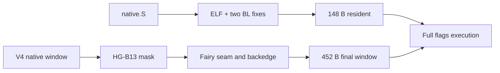

# Fairy flags: source, compressed overlay and actual final loop

The current assembly reconstructs the entire 148-byte resident helper in exact
r4 EN/IT. The452-byte native flags function is also reconstructed from its V4
image and **two owners**: Fairy integration and the AI-scoring HG-B13 mask.
Twenty-four isolated invocations per language execute that final composition
without stubbing a game service. Two new immunity cases distinguish it from a
version that passes the ten historical loop oracles.

See the [owner](../../features/fairy-ai/README.md),
[source-to-ROM method](../test-bench.md#linking-source-to-an-exact-rom) and
[earlier loop diagnosis](../ai-scoring-1.3.1.md). This case adds final-image and
ABI evidence; it does not change the assembly, game, type IDs, settings or saves.



## Cosa farebbe un professionista di alto livello che non sto chiedendo

Trace assembly→ELF→internal relocation→two external BL fixes→resident owner,
then overlay seam→helper→actual flag combiner→native loop and return. Verify
reverse links from the final overlay and its callers. Separate encoded file
positions from decoded RAM, data from instructions and historical execution
fixtures from the exact final image.

The old full-loop fixture built V4 through `fairy_ai.apply_code`. Final r4 is a
shared composition containing a further combiner correction. Preserve that
difference, test a falsifier and examine the private seam ABI rather than
imposing generic callee-save rules on an inline hook. Independent Sol 6.1 review
read raw images, verified ABI/literal relocations and independently observed
new immunity cases and their one-byte counterexample.

## Il materiale più grezzo da cui partire

Use your own exact retail HeartGold, Plus1.1, V1.3 V4 and r4 image per language.
Retail/base identities and preparation requirements are in the
[camera input table](camera-source-rom-1.3.2.md#il-materiale-più-grezzo-da-cui-partire),
V4 identities in the [gift-case input table](gift-source-rom-1.3.2.md#il-materiale-più-grezzo-da-cui-partire)
and [baseline contract](../../sgp131/baseline.py), and r4 identities in the
[game contract](../../distribution/game-1.3.2-r4.json). The reader authenticates
all four whole-file hashes and sizes. No BIOS, save, extracted asset or personal
capture is required or redistributed.

Project sources are [native.S](../../features/fairy-ai/native.S),
[compiler/installer](../../sgp131/fairy_ai.py),
[AI-scoring recipe](../../sgp131/ai_scoring.py),
[composition order](../../sgp131/mechanics_stages.py) and
[reserve subdivision](../../sgp131/reserve.py). The separate reference at
pret/pokeheartgold commit `cb614ad23449d5852b40321dc409c4143872b35c` supplies
`src/battle/battle_util.c`, `trainer_ai.c`, `battle_controller_opponent.c` and
headers for the native signatures and constants. It is not needed by the CLI.
The original native MW compiler/linker is not reconstructed; native-source
correspondence and byte continuity are distinguished from project compilation.

Receipts retain header/game-code/revision, ARM9/autoload, y9/FAT, encoded/decompressed
overlay identity, BLZ footer, literal pools, callers, ELF symbols and executed
code/read/write ranges. JSON includes hashes and addresses, not retail instruction
or chart dumps. Only own-project ELF/payload artifacts are retained locally.

## I metodi e gli strumenti da usare

This run used Python 3.14.7, ndspy 4.2.0, Capstone 5.0.9 and Unicorn 2.1.4. Rebuild
mode uses the existing protected Apple CLT Clang 21.0.0 (`clang-2100.4.1.1`),
executable SHA-256
`fc5e3cbba6ad54059295cad716aacb05ace8235f5f7a6031f1d8c15d24bd6d66`.
The actual compiler and `/usr/bin/clang` launcher have different identities.
Flags are ARMv5TE/ARM946E-S Thumb, freestanding, no builtins and
`assembler-with-cpp`; exact flags and compiler hash are in the receipt.

Set variables to your private inputs and a fresh work directory. Use the Python
environment containing those dependencies (`.venv/bin/python3` in the recorded
run):

```sh
python3 source/features/fairy-ai/tools/attribuisci.py --language EN \
  --rom "$R4_EN" --v4 "$V4_EN" --base "$BASE11_EN" --retail "$RETAIL_EN" \
  --work "$CASE/build" --json "$CASE/report-EN.json"
python3 source/features/fairy-ai/tools/attribuisci.py --language IT \
  --rom "$R4_IT" --v4 "$V4_IT" --base "$BASE11_IT" --retail "$RETAIL_IT" \
  --work "$CASE/build" --json "$CASE/report-IT.json"
PYTHONPATH=source python3 -m unittest sgp131.test_fairy_ai -v
```

`--work` rebuilds and retains `fairy-native.o`, `native.bin` and
`compile-retained.json`. A differing existing artifact is rejected; verified
artifacts are not silently replaced. The default production compiler API still
retains no object. The opt-in retention and collision behavior are tested.

For a host without the pinned compiler, replace `--work ...` with
`--readback-only`. That mode performs final readback, source-recipe replay and
CPU checks, recording `compile.performed=false`; it does not claim a local
assembly/ELF reconstruction. It is independently exercised in the recorded EN
run. No compiler is invoked in that mode.

The two current-image tests use explicit input discovery:

```sh
SGP_R4_ROM_DIR="$R4_DIR" SGP_R4_ROM_NOME='r4-%s.nds' PYTHONPATH=source \
  python3 -m unittest sgp131.test_fairy_ai_rom.CurrentCompositeFlags -v
```

Use your actual EN/IT filename pattern containing `%s`. Missing private inputs
produce an explicit skip, not a pass. Older V4 installation tests remain separate.

### Source, object and insertion

The strict [ELF reader](../../features/options/tools/carica_text.py) resolves
internal Thumb relocations. The assembly deliberately emits two BL placeholders
at decimal offsets24/50 (`0x18/0x32`). The recipe replaces exactly those eight bytes with calls to
`022521C8`; independent Capstone decoding verifies both targets. No system
linker or map file is needed; the retained ELF supplies symbols and text.

| Material | RAM / extent | Identity |
| --- | --- | --- |
| Resident owner | `023D746C`,148 B | SHA-256 `d965f5ffa34f4c696189be23313bf69a51a7e2a7abaf77c0228ea2ed521b2a6f` |
| Flags entry | `023D746D` | Thumb, offset0 |
| Scalar entry | `023D74A9` | Thumb, offset60; static readback only here |
| Packed decoder entry | `023D74CB` | Thumb, offset94 |
| Packed data | owner+108,9 B | two18-entry,2-bit vectors; control flow skips the data/padding |
| Native flag combiner | `022521C8`,80 B | actual inherited code plus HG-B13 |

The current physical resident offset is `00126D2C` in EN/IT. The 148-byte slot is
fully used and is named `fairy-ai.code` under `training.extension`. V4's slot is
exactly zero. Internal relative code does not make the two external BLs freely
relocatable: this build is pinned to the fixed slot.

The own-project ELF SHA-256 in the recorded build is
`9520f79f293523ec84d29b85f6e7b90a00637e4ff9e902cfe0be9350ee403d60`.
Its source SHA-256 is
`42c621081a2cd3dcc0014f9990352171219cfce0226ffffbb435107be038c93f`.
Builder and loader hashes record tool drift separately. Adding optional ELF
retention changes tooling, while the default transformation and 148 game bytes
remain verified unchanged.

### Overlay, native dependencies and revision distinctions

Raw y9 record12 selects FAT file12, decoded base `022378C0`, size `00037380`
(226176 B), BSS0. Current stored size is161600 B, SHA-256
`27ae58f35bb0ce6df5c6c68ef24fb8034901cc217ea133f9e28fd28b7afd4d8c`;
decoded SHA-256 is
`6c95f5d2db58ebb3da1463c6b12bc1e47e7267cd0ccd8cb7905bf2568afb729e`.
The footer `fc76020940fc0000` describes a9-byte BLZ header and expansion to the
stated decoded size. Project in-place BLZ decoding agrees with ndspy's overlay
reader. JSON records language-specific encoded FAT positions. A decoded
instruction has no simple physical `FAT start + RAM offset` position in this
compressed file.

Within the452-byte function `02252054–02252218`, V4→r4 has exactly six changed
bytes: four for the BL at `022520C6`, one for the backedge at `02252138`, one for
HG-B13 at `02252202`. Source replay reconstructs the entire452 bytes, SHA-256
`8959c8bc6e0b1d6fa93cfe4a02068bf2c6441781f73c4d52777dfc29b69d0128`.
The backedge goes to `022520CC`, preserving the native index and avoiding the
second halfword of the hook at `022520C8`. The scalar seam at `0225268E` is
also verified; this case does not execute the full scalar function.

The native80-byte combiner is **not unchanged V4 code**. HG-B13 changes
`movs r0,#4` to `movs r0,#12` at `02252202`: a later weakness must not re-add
SUPER_EFFECTIVE above an existing NO_EFFECT. Current combiner SHA-256 is
`01e30b0ba962543c28c3dd677ed190c8dab6cdecc5a25f0ad3bee17a267f1335`.
The native sparse chart remains336 B at `0226CC7C`, SHA-256
`41c4a8c8f45ae719ee04912c7ae3b6e5ae75a83ec9a270e7555bd6eefa4943da`,
with no Fairy row/column; the resident code supplies that missing part.

Retail IT overlay12 instead loads at `02237860`: flags entry `02251FF4`, chart
`0226CC1C`. The old452-byte window differs at three table-pointer words:
function+0x120/+0x16C/+0x170, pointing to chart columns 0/1/2. Five independently decoded
PC-relative loads establish those aliases. Comparison copies normalize only
those verified pointers; raw hashes are retained and no executed bytes are
normalized. After that explicit relocation, retail/base/V4 windows agree. The
raw retail IT SHA-256 is
`2fb149efd0d73a9d6c5549680d92162ba672c47f41946c7ba34b11ad4d118dde`,
while the common V4 window is
`eb5c3828aa198508aa0644dcf61bad54cf2022dab25923d62e8622a840e952a5`.
The sparse-chart bytes agree across all eight inputs. This is bounded relocation
correspondence, not a claim that all regional overlay addresses or bytes agree.

### Callers, private ABI and actual execution

Eight current BL callers reach `02252054`: overlay10 at `0221F78E`, `0221FA3A`,
`0221FAC8`, `0221FC44`, `0221FCD4`, `0222017C`, `02220210`, and overlay12 at
`022589FC`. Each is read from the actual decoded image and decoded independently.
Source counterparts are the trainer AI and post-KO replacement selector. These
are static links, not eight observed natural encounters.

The native signature takes ctx, move number, default move type and attacker
ability in r0–r3, then target ability, held-item effect, two defender types and
flags pointer on the stack. The tested fixture uses Move1, zero context, no
ability/item effects and valid type IDs 0–17. A zero move-type argument uses the
context's zero-initialized Normal move-type field.

The parent saves 24 bytes and allocates 16 local bytes. The hook sees SP=parent−40;
`[sp+0x0C]` is resolved attack type, `[sp+0x30]` first defender type, and r6 the flags
pointer. It loads r4/r5, pushes LR, then `[sp+0x38]` refers to the second defender
type. It intentionally returns r4=0 for the native loop; r5 is also live state,
not a generic preserved-register contract. The full parent restores r4–r11/SP.
The inline helper must not be tested as an ordinary callee-save function.

Its single LR push gives internal SP mod8=4 for the two possible combiner calls;
native loop calls use mod8=0. The current decoder and combiner are leaf code
without stack loads. The proved private transport therefore does not imply
that every call is8-byte aligned or that a changed combiner ABI would be safe.
All calls require r0 effect0/5/20 and r1 pointing to the actual flags buffer.

There are 12 literal type cases, each with initial flags 0 and `0xA5000000`:24
invocations per language. They cover the ten historical loop cases plus Dragon
against Fairy/Dragon in both orders. No service is stubbed. Code executes only
in the declared Thumb function/helper regions, excluding packed data and the
unused scalar tail. The helper executes once; the BL suffix is never entered.
Checks require an actual return, SP/r4–r11/Thumb preservation, unchanged owner/
function bytes, flags and incoming-stack canaries, and bounded guest writes.
Executed ranges and immutable data reads are hashed in each result.

The prologue rewrites three incoming argument home words (item and both types).
Those writes are allowed explicitly and their values must remain unchanged;
other guest writes are limited to the stack and four-byte flags output. Maximum
observed stack depth is48 B. The 4 KiB allowed stack area is a fixture limit, not
an inferred universal requirement. The upper flag bits are preserved in all
24 tested cases.

### Counterproofs, results and remaining scope

A RAM-only counterproof restores the old combiner mask12→4. All ten historical
literal loop oracles still pass, but the two Dragon/Fairy cases produce10
(NO_EFFECT plus incorrectly re-added SUPER_EFFECTIVE) instead of8. The new
oracle rejects both. This is a coverage distinction for a new composition
question, not a retroactive claim that the original loop diagnosis was invalid.
All input files and the final positive execution image remain unchanged.

Nine helper/compiler tests pass, including opt-in object retention, collision
refusal and the unchanged no-artifact default. Two new current-image methods
exercise immunity/unrelated flags and the semantic counterexample in both
languages. Nine additional negative checks reject packed-data, seam, old-loop,
old-mask and literal/PC-reference mutations. Independent review repeated the
new immunity examples, their counterexample and regional pointer analysis.

Final EN/IT source/readback runs exited0 in0.881/1.716 seconds with OS peak RSS
324,550,656/330,940,416 bytes, under the1GiB budget. Logs were bounded to2MiB.
These are host verification costs, not game performance measurements. No full
ROM composition or new natural capture was produced.

- **Documented provenance:** assembly, strict loader, compiler/flags, fixed grant,
  seam recipe, HG-B13 owner and exact input identities.
- **Reconstructed binary correspondence:**148-byte owner/retained ELF, two BL
  fixes,452-byte final function, backedge, packed data and bounded chart aliases.
- **Demonstrated semantics:**24 declared invocations and12 counterproof runs per
  language, with actual native combiner and ABI/write/read checks.
- **Observed activation:** isolated native-function invocation only.
- **Unattributed or untested links:** original native toolchain, naturally reached
  caller state, all abilities/items/moves/type combinations, full scalar path,
  AI decisions/RNG, timing, SAVE/cold restart and hardware remain outside scope.

The reusable result is a way to attribute shared native code to all contributing
owners, retain raw revision differences and discriminate old-test coverage from
a new dependency. No game optimization is established. Any successor changing
the combiner's code, stack ABI, pointer data or input domain needs renewed
closure checks. Full scalar attribution is the next independent executable path.

The subsequent [scalar case](fairy-scalar-source-rom-1.3.2.md) closes that
separate host path using these canonical build artifacts, without repeating
the flags campaign. Its results do not widen this case's declared coverage.
