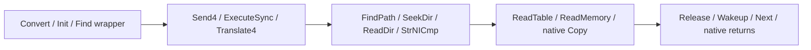

# Complete cached Convert: the move archive path reaches file ID140

Seven isolated native executions passed (one probe and two three-run matrices),
with zero service models or runtime host writes. CPU-free raw verification passed
in both resource modes; independent final raw review is recorded separately.
The complete API starts at `FS_ConvertPathToFileID`, initializes its temporary
file, resolves the real path and returns through Send, ExecuteSync, Translate,
Release, Wakeup and Next. It composes the [complete FindPath
case](native-fs-cached-findpath-source-rom-1.3.2.md) with previously qualified
wrappers; it does not infer that earlier isolated callers share this new RAM.
The [owner](../../features/trainer-strategy/README.md) links this case to the
[full ROM build and composition map](../test-bench.md#from-the-source-tree-to-the-complete-rom).

## Professional checks beyond the minimum

Recover a useful API boundary before adding another subsystem. PRET HeartGold
`heartgold.us/filesystem.csv:108` identifies `files/poketool/waza/waza_tbl.narc`
as `/a/0/1/1`. In the pinned game source, `filesystem_files_def.h` calls this
NARC index11; the exact ROM's FNT independently yields fileID140. Member310
is another namespace. `src/filesystem.c::ReadWholeNarcMemberByIdPair` selects
`sNarcFileList[narc_id]`, then uses Open/Seek/Read/Close. This case proves the
lookup API boundary only; it does not execute that subsequent payload reader.

Check both directions: source/recipe to ELF/installed bytes, and the real path,
FNT directory records and consumer back to the recipe/source. A final ID alone
cannot show which instructions wrote it. An initially completed output is a
separate falsifier; its native store preimages must differ even when the final
CPU and entire mapped memory converge. OFF must retain enforcement without
recording observations. Independent review checks addresses, ABI, IRQ semantics
and the entire chronology, not only a success Boolean.

## Raw starting material, identity and provenance

Use your owned r4 EN ROM,152786844bytes, SHA-256
`2e30d6960bb059615fca7527700d86f8282e82ccbe99bf62e22f027453dc3d3d`,
IPKE/revision0. The IT readback image is159029760bytes, SHA-256
`13ebac02bdea3036511773587e6603ce6834e25f4b13d1a4662c3e954bfd5d4a`.
IT byte agreement is separate from execution; EN runtime resources are not
transferred to an Italian natural caller. The [SeekDir
case](native-fs-cached-seekdir-source-rom-1.3.2.md#raw-starting-material-and-input-identities)
describes the optional qualified historical MainRAM gzip. Without private
captures, omit `--snapshot`; the ROM-only mode is reproducible with declared
synthetic ARC and root initialization.

The source reference is the clean SDK/game checkout at
`cb614ad23449d5852b40321dc409c4143872b35c`. The newer research
[PRET HG snapshot](https://github.com/pret/pokeheartgold/tree/6bf138d6035aa6b43d6f8f4132a12df70f86dcec)
supplies independent file metadata; it does not replace the production source
pin, materialize missing SDK dependencies or establish an Italian full build.
Sources used for semantics are `FS_file.c`, `fs_send_command.c`, `FS_command.c`,
`FS_command_default.c`, `FS_archive_prefix.c`, `fs_private.h`, `mi_memory.c`,
`os_thread.c` and `os_system.c`; the verifier authenticates these nine files
and18 original ABI headers against their exact hashes.

`a/0/1/1\0` is eight initialized bytes at RAM`0x0210F198`, current ROM
`0x00113198`. FAT140 is `[0x01093800,0x0109645C)`,11356bytes; its payload is
not read here. The FNT hash is
`80816c1f6829d388b81d53fa9b5eb5fd65dbef654c8fb03e0735cad714b03afe`;
directory IDs0,1,2,4 lead to file140. Four directory records, twelve one-byte
tag/name reads and four two-byte child IDs imply20 logical copies. Some names
mismatch before the selected entry; those StrNICmp branches are exercised.

The relative path needs `current_dir_pos` at RAM`0x021E362C`,12bytes with SHA
`d706e4423ea8e7dbdf21ba2d4805ce434739559758815b35de6b0257ddb4e567`.
This is **BSS**, not a physical initialized ROM window. ARM9 code settings at
physical`0x00004BA0` declare `[0x02111860,0x021E5900)` as static BSS; the reader
checks containment and descriptor magic. The optional historical snapshot
provides the root value at its own checkpoint; it does not observe boot stores
or this API entry. ROM-only mode explicitly initializes `{ARC,0,0,0}`.
No RAM-minus-base mapping is claimed for BSS. No overlay or compressed segment
owns these initialized function windows; physical readback uses the exact
ARM9 header mapping. Autoload/BSS ownership remains a separate check.

## Methods, recovered compilation and installed bytes

Eighteen retained ELF comparison objects cover3704bytes:3688code bytes (922 ARM
starts) and16literal-pool bytes. The36-byte default command table at
RAM`0x0210E124` adds data. Their installed current EN/IT bytes agree; no new
compilation is needed to compose them. Current initialized physical offsets
are `RAM - 0x02000000 + 0x4000`, checked against the ARM9 header bounds.

|Component|RAM start|Extent|Complete text SHA-256|
|---|---|---|---|
|init|`0x20d7f98`|40 code|`131f15b7db06da746cb03744ffda8f5453b1c6c2fbdf8f0dacab41326e10421f`|
|convert|`0x20d8180`|64 code|`8455d062eee662f58fefa731950eab06ecedb77279478b2ef41123ab5128d172`|
|find|`0x20d7fc0`|320 code +4 pool|`baf1c233ca8efcaa3ca58e996fe2f01e437fad5753dca7bbe1e6e782dd9abcf8`|
|send|`0x20d7788`|420 code|`ca74d4ff51db8cb32a7d6235e6b4d453554d65ac6162dc4092b7f285d0e4051a`|
|execute|`0x20d7744`|68 code|`44b2f23b47f01552bd478420b9a14ae0fc2ed6013e7d551d5112075264a43d55`|
|release|`0x20d6864`|92 code|`658daf608846bdeca5f8d48b8b0ea7d46280ebcd2ef783fce8b5f9e12735f568`|
|wakeup|`0x20d1ecc`|104 code|`25c7d621d6b4d855be6828b9ec8d98162df8ecdda5a22db405caf344aa4102db`|
|next|`0x20d749c`|532 code|`d3785eb030614f3050cb9ef747e3a173e534c40ef5ffa3d75c95acd6fa778e9c`|
|disable|`0x20d3a38`|20 code|`a8cdb747f9936730571b220bb9570615892665b120713ffc59b1cb2d7dee76ff`|
|restore|`0x20d3a4c`|24 code|`46b5111b6fad094dfff177dca974d33b477cb72772ecfe95b74b1c7f656bc4fd`|
|translate|`0x20d68c0`|396 code +4 pool|`f1df0f035e516cdfff9df4668530ca636f88b9a1a70d86804b9671c8bce7341a`|
|seekdir|`0x20d6bec`|148 code +4 pool|`3b0c0a3721993fdf50396c8cf2102e1ea43f92149f4f763586d919e21d680f81`|
|read_table|`0x20d6aa0`|192 code|`0119efeea4f6d4bdf200624a7ff9c3cee2790fee1e8f8ea8592420ed4aaebf92`|
|read_memory|`0x20d7484`|24 code|`b433aaee1c510f86a113d1fe9b857435b6f615e96df11f285c1e8991d6eae0a0`|
|copy|`0x20d4a50`|384 code|`369b6f2e559f13da0a9ba7a741ebf8ca3213db866a8f4eb97460809d8b54b86e`|
|findpath|`0x20d6db0`|484 code|`70727f66b05763ecfc2b1819f4580f5e0aa029b4cd6cc269776d722fa560e63e`|
|read_dir|`0x20d6c84`|296 code +4 pool|`15628ccff63ff271734323992030e598370935f555f17feac61e4c01071c088b`|
|strnicmp|`0x20d6a50`|80 code|`65b5093eaafd96f6f77545aee4103cde48dfd8686795e820c3add61f5fb15c0f`|

Pools are the final four bytes of SeekDir, ReadDir, Translate and Find wrapper.
Next's entire532bytes are code. Its address`0x020D749C` was a synthetic stop
in earlier isolated cases: **load the real body here**, never the earlier zero
sentinel. The new outer stop is disjoint RAM`0x022F0180`, stopped before
instruction execution (a hook does not imply no instruction fetch).

The original Metrowerks compiler/objects are unavailable. Project assembly
recipes reconstruct byte-identical comparisons; original C code generation
and whole-ROM-from-C reconstruction are separate unresolved claims. Builders
compile original header layouts and retain compiler commands, flags, dependency
hashes, source extracts, object hashes and exit codes in `manifesto.json`.
The qualified compiler is Clang21, SHA-256
`fc5e3cbba6ad54059295cad716aacb05ace8235f5f7a6031f1d8c15d24bd6d66`.
Keep those build receipts. The new composition verifier loads ELF independently,
rejects relocations, checks entry symbols and complete text against ROM;
**matching text does not authenticate a newly supplied object's compiler origin**.

The existing recipes and builders are:

- [compila_fs_init.py](../../features/trainer-strategy/tools/compila_fs_init.py) and [fs-init.S](../../features/trainer-strategy/sorgenti/fs-init.S).
- [compila_fs_convert.py](../../features/trainer-strategy/tools/compila_fs_convert.py) and [fs-convert.S](../../features/trainer-strategy/sorgenti/fs-convert.S).
- [compila_fs_find.py](../../features/trainer-strategy/tools/compila_fs_find.py) and [fs-find.S](../../features/trainer-strategy/sorgenti/fs-find.S).
- [compila_fs_send.py](../../features/trainer-strategy/tools/compila_fs_send.py) and [fs-send.S](../../features/trainer-strategy/sorgenti/fs-send.S).
- [compila_fs_exec_sync.py](../../features/trainer-strategy/tools/compila_fs_exec_sync.py) and [fs-exec-sync.S](../../features/trainer-strategy/sorgenti/fs-exec-sync.S).
- [compila_fs_release.py](../../features/trainer-strategy/tools/compila_fs_release.py) and [fs-release.S](../../features/trainer-strategy/sorgenti/fs-release.S).
- [compila_os_wakeup.py](../../features/trainer-strategy/tools/compila_os_wakeup.py) and [os-wakeup.S](../../features/trainer-strategy/sorgenti/os-wakeup.S).
- [compila_fs_next.py](../../features/trainer-strategy/tools/compila_fs_next.py) and [fs-next.S](../../features/trainer-strategy/sorgenti/fs-next.S).
- [compila_fs_wait.py](../../features/trainer-strategy/tools/compila_fs_wait.py) and [fs-wait.S](../../features/trainer-strategy/sorgenti/fs-wait.S).
- [compila_fs_translate.py](../../features/trainer-strategy/tools/compila_fs_translate.py) and [fs-translate.S](../../features/trainer-strategy/sorgenti/fs-translate.S).
- [compila_fs_cached_seekdir.py](../../features/trainer-strategy/tools/compila_fs_cached_seekdir.py) and [fs-cached-seekdir.S](../../features/trainer-strategy/sorgenti/fs-cached-seekdir.S).
- [compila_fs_cached_findpath.py](../../features/trainer-strategy/tools/compila_fs_cached_findpath.py) and [fs-cached-findpath.S](../../features/trainer-strategy/sorgenti/fs-cached-findpath.S).

These are comparison artifacts, with no installer. The existing Plus composer
remains responsible for the full game image; do not replace its production
pin with the research PRET checkout or insert attribution objects into a ROM.

### State, ABI, callbacks and lifetime



CPU, output, stack and sparse pages are synthetic. Entry`0x020D8180` receives
R0=`0x022F0140`, R1=`0x0210F198`, explicit R2–R12 cookies, SP=`0x023FD000`,
LR=`0x022F0180`, CPSR=`0x6000001F`. Convert itself allocates scratch FSFile72
at SPtop−88=`0x023FCFA8`. Init sets only its documented fields; untouched
bytes begin as A5 until native writers replace them. No P81 file is grafted in.
The full nested frame is464bytes with56 untouched guard bytes below it;
14 synthetic4KiB pages are compared completely, including unused neighbors.

Start ARC flag7 and empty list/queues. Native Send sets RUNNING and file status
`0x45` (69decimal); native Release/Next removes the link and returns ARC to7.
For the historical ARC only, project **proc_flag`0x602` to`0x2` before entry**,
clearing ACTIVATE/IDLE masks`0x600`, preserving WRITEFILE's unsupported bit.
The freezer records the preimage and projected value. Other ARC bytes and
callback pointers remain unchanged. ROM-only ARC has declared synthetic unused
fields and proc_flag0; it is a different fixture, judged separately.

Keeping natural`0x602` would invoke `FSi_RomArchiveProc`, CARD locks and shared
bus/OS state. Those are unqualified here. This explicit input projection limits
the result to the cached lookup composition; it is not natural card protocol
activation. Never initialize RUNNING17 as in P81: Send would take a different
scheduling/Sleep route. Nonempty queues, cancel/suspend, async and routed archive
callbacks are rejected by the finite domain, not served by host functions.

Native Disable/Restore execute44 authentic bytes, five calls each. The
[new finite IRQ checker](../../features/trainer-strategy/test/arm32_sync_oracle.py)
is a bounded derivative of the unchanged
[P81 arithmetic helper](../../features/trainer-strategy/test/arm32_cached_oracle.py).
It admits only CPSR MRS→R0/R1 and MSR control←R1/R2, changing I only; no banked
mode, Thumb, FIQ transition or interrupt delivery. Restore preserves **live**
NZCV flags and restores I, not all flags from before Disable. An AST regression
checks that no other parent semantics drifted. Fifteen initial kernels plus the
AST guard, old IRQ rows and old P81 contexts qualify the extension before CPU.
These are related source predictors, not two independent CPU implementations.

The functional FNT parser is separate from the finite instruction predictor.
Both are compared to original bytes running on Unicorn2.1.4 CPU17 (CortexA15),
with zero service models/runtime host writes; it is not ARM946 timing/cache/IRQ
hardware. Only PC and read/write site/address/width enforcement sets enter the
producer, never predicted registers, pages or store values. Static instruction
memory classes (172 read sites,110 write sites) are rederived from the exact
code before execution; native ledgers then match every full16 context.

## Reproduce with your own inputs

Run from the repository root. Reader/freezer/prepare/verify require Python3 and
Git, using the existing project environment. Native probe/matrix also need
Unicorn2.1.4; no emulator installation, BIOS, save or personal capture is needed.
Rebuilding comparison objects additionally needs the authenticated compiler and
clean SDK reference; this does not install those tools. Refer to the
[source build instructions](../../README.md) for the complete game's inputs.

Choose a fresh private output outside `source/`, at least10GiB free after a
planned1GiB peak, one producer,180s/1GiB RSS/2MiB log/16MiB case limits. Do not
point build outputs at an existing verified candidate or fallback.

```sh
export SGP_CONVERT_ROM=/absolute/path/to/owned-exact-r4-EN.nds
export SGP_CONVERT_REF=/absolute/path/to/clean-pinned-sdk-checkout
export SGP_CONVERT_OUT=/absolute/path/to/fresh-private-convert-case
export SGP_CONVERT_CC=/absolute/path/to/authenticated-clang
mkdir "$SGP_CONVERT_OUT"

# Reuse verified objects if available; otherwise build these small comparisons
# sequentially, retaining each manifesto.json. No game image is generated.
for recipe in fs_init fs_convert fs_find fs_send fs_exec_sync fs_release \
    os_wakeup fs_next fs_wait fs_translate fs_cached_seekdir fs_cached_findpath
do
  python3 "source/features/trainer-strategy/tools/compila_${recipe}.py" \
    --uscita "$SGP_CONVERT_OUT/recipe-$recipe" \
    --cc "$SGP_CONVERT_CC" --reference "$SGP_CONVERT_REF" || exit
done

python3 - <<'PYMAP'
import json, os
from pathlib import Path
out=Path(os.environ['SGP_CONVERT_OUT'])
names={'convert': ('fs_convert', 'fs-convert.o'),
 'copy': ('fs_cached_seekdir', 'copy.o'),
 'disable': ('fs_wait', 'fs-wait-disable.o'),
 'execute': ('fs_exec_sync', 'fs-exec-sync-command.o'),
 'find': ('fs_find', 'fs-find-path.o'),
 'findpath': ('fs_cached_findpath', 'findpath.o'),
 'init': ('fs_init', 'fs-init.o'),
 'next': ('fs_next', 'fs-next-command.o'),
 'read_dir': ('fs_cached_findpath', 'read_dir.o'),
 'read_memory': ('fs_cached_seekdir', 'read_memory.o'),
 'read_table': ('fs_cached_seekdir', 'read_table.o'),
 'release': ('fs_release', 'fs-release-command.o'),
 'restore': ('fs_wait', 'fs-wait-restore.o'),
 'seekdir': ('fs_cached_seekdir', 'seekdir.o'),
 'send': ('fs_send', 'fs-send-command.o'),
 'strnicmp': ('fs_cached_findpath', 'strnicmp.o'),
 'translate': ('fs_translate', 'fs-translate-command.o'),
 'wakeup': ('os_wakeup', 'os-wakeup-command.o')}
(out/'objects.json').write_text(json.dumps({
    name:str(out/('recipe-'+owner)/filename)
    for name,(owner,filename) in names.items()},indent=2)+'\n')
PYMAP

python3 source/features/trainer-strategy/tools/rileggi_fs_cached_convert.py \
  --rom "$SGP_CONVERT_ROM" --json "$SGP_CONVERT_OUT/resources.json"
python3 source/features/trainer-strategy/tools/congela_fs_cached_convert.py \
  --rom "$SGP_CONVERT_ROM" --json "$SGP_CONVERT_OUT/input.json"

# Freeze before predicting or executing. Each command requires fresh output.
for mode in prepare probe matrix
do
  python3 source/features/trainer-strategy/tools/attribuisci_fs_cached_convert.py     --mode "$mode" --rom "$SGP_CONVERT_ROM" \
    --objects "$SGP_CONVERT_OUT/objects.json" --reference "$SGP_CONVERT_REF" \
    --input-contract "$SGP_CONVERT_OUT/input.json" \
    --out-dir "$SGP_CONVERT_OUT/$mode" || exit
done

# CPU/compiler-free rejudgment of saved raw and all control evidence.
python3 -I -S -B source/features/trainer-strategy/tools/attribuisci_fs_cached_convert.py \
  --mode verify --rom "$SGP_CONVERT_ROM" \
  --objects "$SGP_CONVERT_OUT/objects.json" --reference "$SGP_CONVERT_REF" \
  --input-contract "$SGP_CONVERT_OUT/input.json" \
  --raw-dir "$SGP_CONVERT_OUT/matrix" --out-dir "$SGP_CONVERT_OUT/verified"

python3 -I -S -B -m unittest discover -s source/features/trainer-strategy/test \
  -p 'test_fs_cached_convert*.py'
python3 -I -S -B -m unittest discover -s source/features/trainer-strategy/test \
  -p test_arm32_sync_oracle.py
```

The object JSON accepts exactly eighteen named paths; relative paths are relative
to the current working directory. CLI verification never imports Unicorn or runs
a compiler. It reauthenticates resources, source/recipe/ELF bindings and frozen
context, rejects nonlocal raw manifest paths, predicts again and compares complete
registers, ledgers and pages. To use the optional historical snapshot, pass the
same `--snapshot /your/qualified/MainRAM.bin.gz` to reader, freezer and every
attribution command; provenance and source bindings must match that mode.
The optional `--it-rom` reader argument compares current initialized bytes/BSS
bounds only. It does not transfer EN RAM to IT.

## Results, counterexamples and remaining gaps

Native execution matches every prediction below. Before CPU, four source predictions (two input modes,
normal/precompleted) agree on2744 instructions/596 distinct PCs/819 reads/
616 stores/peak464. Callgraph:1Convert/Init/Find/Send/ExecuteSync/Release/Wakeup/
Next/FindPath;11Translate;4SeekDir;6ReadDir/StrNICmp;20ReadTable/ReadMemory/Copy;
5Disable/Restore. Returned full16 predicts BOOL1, R1=`0x6000009F`,
R2=`0x6000001F`, R3 and R4–R11 preserved, IP=`0xFFFFFFF0`, SP restored,
LR=`0x020D76A4`, CPSR=`0x2000001F`.

Final scratch File72 has zero links/status/error/queue, command4, ARC, property
`{ARC,own4,index141,FNT+510,parent2}`, mutated argument union (entry buffer at
SPtop−368,skip0,pos0), original path/result pointers. Root and full projected
ARC remain unchanged. POP PC does not restore LR; earlier standalone LR1 or
other modeled residuals are not imported into this composition.

The precompleted-output control changes only the eight initial output bytes.
The expected raw differences are store588/589 preimages at native PCs
`0x020D6F3C`/`0x020D6F44`; flow/reads/final CPU/all14pages converge. The verifier
must reject camouflaging the input and deleting either writer. OFF leaves all
counters/enforcement active with empty observed ledgers and identical final
CPU/pages. These are finite conditions exercised, not universal API coverage.

Distinguish documented source provenance, reconstructed binary agreement,
finite semantic agreement and observed isolated activation. Still unproven:
original C compiler/full ROM rebuild, natural caller/DTCM context, card-lock
protocol, async/scheduling, Italian execution, physical IRQ/timing and SAVE on
hardware. No ROM, save, settings, IDs, ABI, player input or game behavior changes;
no Nintendo DS memory/performance improvement is claimed. An opportunity is to
qualify the real card protocol or join the next Open boundary with coherent RAM;
those need new finite contracts and proofs, not a host callback substitute.


Two OFF executions retain the same full16 return and all14 final pages with no
observed ledgers. Both precompleted controls converge exactly while changing
only store588/589 preimages; six forged raw variants are rejected specifically
for native stores. All seven guests execute2744 native instructions with2745
code callbacks including the stopped gate; the first probe and natural normal
share the same input, so seven runs are not seven independent input coverages.
No source/expected-state adjustment followed the first guest.

31 new ROM-free tests pass:16 finite arithmetic/IRQ/AST regressions and15
reader/owner/CLI tests. The derivative was also checked without a new CPU against
32 earlier IRQ rows/64 leaf calls and five old FindPath ON raws (including a
duplicate input). Original parent arithmetic source remains byte-identical.
Host matrices take under half a second and under54MB OS peak RSS in this case;
these host costs are not DS timings or a gameplay speedup.

The [subsequent complete Open case](native-fs-cached-open-source-rom-1.3.2.md)
composes this API with Fast and the actual cached FAT/default Direct handlers.
It allocates a new coherent caller frame and checks Convert's directory only
while live; later frames may reuse it. This case's runtime source and raw
bindings remain unchanged.
