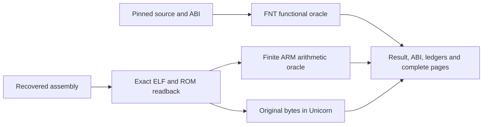

# Complete cached FindPath: a pathname reaches its native file ID

The retained native `FSi_FindPathCommand` resolves `a/0/0/0` to fileID129 through
Translate, SeekDir, ReadDir, ReadTable, the memory callback, Copy and StrNICmp.
Seven isolated executions passed with zero service models or runtime host writes.
The input uses authenticated cached filesystem resources or a separately declared
ROM-derived fixture; CPU, file, pathname, result and stack are synthetic.

This closes the complete normalized-path callee, after the
[cached SeekDir case](native-fs-cached-seekdir-source-rom-1.3.2.md). It does not
upgrade the [earlier Find caller](native-fs-find-caller-source-rom-1.3.2.md) or
claim a natural Send/default entry. The [owner](../../features/trainer-strategy/README.md)
and [full ROM build map](../test-bench.md#from-the-source-tree-to-the-complete-rom)
connect this component check to the existing source/composition pipeline.

## Professional checks beyond the minimum

Choose a real pathname and complete the lookup before adding more prefixes.
Separate its meaning from its numeric ID: newer PRET HeartGold
`heartgold.us/filesystem.csv:97` identifies `/a/0/0/0` as
`files/battledata/script/move_script.narc`; ID129 comes independently from the
exact current FNT. The earlier NARC140 consumer is a different path and remains
outside this test. Keep upstream references read-only and production pins stable.

The entire eight-function chain needs byte, halfword and word accesses. A logical
one-byte copy can read/write a halfword while preserving its neighbor. Do not
replace those accesses with host memcpy or infer all register values from the
stored16bits. Review also checks unsigned arithmetic, conditional instructions,
writeback, shared sync flags and POP PC without restoring the LR register.

The reusable arithmetic checker was qualified before this new guest against
six earlier SeekDir profiles:600 complete register contexts,162 stores,210 reads
and all mapped pages match the independent manual oracle and old native raws.
Synthetic kernels test underflow/carry/overflow, shifts, conditional access,
post-indexing, RMW, base-register aliases and returns. Independent review added
576 shift checks and rejected unsupported false-predicate encodings. This is a
finite instruction checker, not a complete ARM processor or a timing model.

## Raw starting material and provenance

Use your owned exact r4 EN image,152786844bytes, SHA-256
`2e30d6960bb059615fca7527700d86f8282e82ccbe99bf62e22f027453dc3d3d`.
Its header is IPKE/revision0. Presentation language and game code are different
identities. IT is covered by byte readback, not execution in this case; the
[preceding case](native-fs-cached-seekdir-source-rom-1.3.2.md#raw-starting-material-and-input-identities)
lists both images and the exact optional historical MainRAM gzip identity.

Without private captures, omit `--snapshot`: the reader takes FAT/FNT from your
ROM and builds a declared synthetic ARC. With the qualified historical gzip,
resource slices are authenticated by streaming its entire decompressed hash.
The input receipt distinguishes these modes. Neither provides the missing
natural DTCM stack or precise natural FindPath entry registers.

The FNT hash is
`80816c1f6829d388b81d53fa9b5eb5fd65dbef654c8fb03e0735cad714b03afe`.
Its four selected records are:

| Directory | Record start / first file / raw parent | First entry | Target |
| --- | --- | --- | --- |
|0|368 /129 /46|a|directory1|
|1|431 /129 /F000|0|directory2|
|2|444 /129 /F001|0|directory3|
|3|485 /129 /F002|0|file129|

The source reference remains the clean reconstructed SDK checkout at
`cb614ad23449d5852b40321dc409c4143872b35c`. Relevant files are
`lib/NitroSDK/src/fs/FS_command_default.c`, `FS_command.c`,
`FS_archive_prefix.c`, `mi/mi_memory.c` and pinned FS/OS headers.
The newer research HG snapshot is
[`6bf138d6035aa6b43d6f8f4132a12df70f86dcec`](https://github.com/pret/pokeheartgold/tree/6bf138d6035aa6b43d6f8f4132a12df70f86dcec).
Its metadata helps identify the file; absent wrapped SDK dependencies do not
replace the authenticated older source/ABI reference.

## Methods and component chain

Three new comparison objects are assembled with the qualified Clang21 compiler:

| Component | RAM | Current ROM offset | Extent | SHA-256 |
| --- | --- | --- | ---: | --- |
|FindPath|`0x020D6DB0`|`0x000DADB0`|484 code|`70727f66b05763ecfc2b1819f4580f5e0aa029b4cd6cc269776d722fa560e63e`|
|ReadDir|`0x020D6C84`|`0x000DAC84`|296 code +4 pool|`15628ccff63ff271734323992030e598370935f555f17feac61e4c01071c088b`|
|StrNICmp|`0x020D6A50`|`0x000DAA50`|80 code|`65b5093eaafd96f6f77545aee4103cde48dfd8686795e820c3add61f5fb15c0f`|

The [builder](../../features/trainer-strategy/tools/compila_fs_cached_findpath.py)
reuses the pinned SeekDir builder function with explicit component metadata,
recipe, layout and ELF extractor; shared source is unchanged. Three ELF objects
match864bytes, with no relocations and18 authenticated header dependencies.
Original Metrowerks C code generation is unavailable: these are recovered
assembly comparisons and header-layout checks, not an original C rebuild.

Retain the four752-byte objects from the
[SeekDir recipe](../../features/trainer-strategy/tools/compila_fs_cached_seekdir.py)
and the400-byte [Translate recipe](../../features/trainer-strategy/tools/compila_fs_translate.py).
The default table adds36 data bytes. Total2052bytes contains2004code bytes
(501 ARM starts), three4-byte pools and the table. Independent ELF parsing and
ARM9/autoload decoding compare all three new objects across retail→base→V4→r4
in EN/IT (24 comparisons), plus current physical windows. Translate's separate
retail-Italian literal relocation remains documented in its own case.

FindPath has no literal pool; `fsi_root_path` belongs to the following GetPath
function. ReadDir maskFFF is at `0x020D6DAC`, separate from SeekDir's mask at
`0x020D6C80` and Translate's table pointer at `0x020D6A4C`.

### Independent checks and activation conditions



The [resource reader](../../features/trainer-strategy/tools/rileggi_fs_cached_findpath.py)
derives ID129 and15 logical table reads without a CPU: four8-byte directory
records, eight1-byte tag/name reads and three2-byte child IDs. The separate
[arithmetic oracle](../../features/trainer-strategy/test/arm32_cached_oracle.py)
predicts every full register context and physical access from authenticated
instructions. An independent source/block derivation predicts1899 contexts,
421 stores and570 reads before the first new native run.

[Freezing](../../features/trainer-strategy/tools/congela_fs_cached_findpath.py)
records complete input page hashes, R0–R14/CPSR and separate PC. Eleven synthetic
4KiB pages hold code/resources and guarded objects: FILE `0x022F0000`/72,
PATH `0x022F0100`/8, result `0x022F0140`/8, stack top `0x023FD000`.
Objects have16-byteD3 guards; maximum frame280 has56-byte lower guard.
These are bank arenas, not claims of free game RAM or a captured DTCM stack.

FILE.stat is `0x45` (69decimal), command4, error2; the argument starts at root
with index/position0 and find_directoryFALSE. This differs from the unused
45decimal status in the earlier isolated SeekDir fixture. ARC flag7 becomes
17hex through an explicit initial RUNNING projection. Natural proc_flag602 and
ROM-derived proc_flag0 both exclude command2/3 callbacks; each input keeps its
own complete ARC. No archive proc, card, allocator, IRQ or sleep is modeled.

Native Translate and ReadTable share the sync bit:17→217→17, including
idempotent stores. It is not a nesting counter. All eight Translate completions
and15 real memory callbacks remain in the recorded path. ReadDir mutates the
scratch FILE argument union; the verifier preserves those final bytes.

MI_Copy's unaligned2-byte ID read uses halfwords at `0x023BF738` and
`0x023BF73A`. IP becomes `0x0081F002`, while STRH stores onlyF002. A tag RMW
changes7001→8101 and preserves the neighboring01 left by an earlier Seek record.
No frame or neighbor is reset to A5 between calls.

Final result is `{ARC,129}`; final directory property is
`{ARC,own_id3,index130,pos0x023BF76F,parent2}`. R0=0,R1=129,R2=ARC,
R3 and R4–R11 are restored entry values, IP=FFFFFFEF, SP restored,
CPSR6000001F. **LR is1**: StrNICmp uses it as an index and returns through
POP PC. The synthetic return sentinel `0x020D6F94` is stopped before execution;
its zero fixture bytes are not authenticated GetPath instructions.

### Reproduce with your own inputs

Requirements: Python3.9+; the clean SDK reference above; authenticated Apple
Clang21 SHA-256 `fc5e3cbba6ad54059295cad716aacb05ace8235f5f7a6031f1d8c15d24bd6d66`
for the recipes; Unicorn2.1.4 for new native runs. Resource reading, freezing,
source arithmetic and existing-raw verification use only Python's standard
library and Git. Keep all fixtures, outputs and extracted data private.

```sh
# Set these to your own environment and private locations, from repository root.
export PYTHON=/path/to/venv/bin/python3
export ROM_EN=/private/path/to/exact-r4-EN.nds
export SDK_REFERENCE=/private/path/to/clean-pinned-SDK
export CASE_OUT=/private/path/to/new-findpath-case
export CC=/Library/Developer/CommandLineTools/usr/bin/clang
mkdir "$CASE_OUT"

"$PYTHON" -B source/features/trainer-strategy/tools/rileggi_fs_cached_findpath.py \
  --rom "$ROM_EN" --json "$CASE_OUT/resources.json"
"$PYTHON" -B source/features/trainer-strategy/tools/congela_fs_cached_findpath.py \
  --rom "$ROM_EN" --json "$CASE_OUT/input.json"
# Reuse these two verified recipe directories if already available.
"$PYTHON" -B source/features/trainer-strategy/tools/compila_fs_cached_seekdir.py \
  --reference "$SDK_REFERENCE" --uscita "$CASE_OUT/cached" --cc "$CC"
"$PYTHON" -B source/features/trainer-strategy/tools/compila_fs_translate.py \
  --reference "$SDK_REFERENCE" --uscita "$CASE_OUT/translate" --cc "$CC"
"$PYTHON" -B source/features/trainer-strategy/tools/compila_fs_cached_findpath.py \
  --reference "$SDK_REFERENCE" --uscita "$CASE_OUT/recipe" --cc "$CC"

"$PYTHON" -B source/features/trainer-strategy/tools/attribuisci_fs_cached_findpath.py \
  --mode prepare --rom "$ROM_EN" --recipe-dir "$CASE_OUT/recipe" \
  --cached-recipe-dir "$CASE_OUT/cached" --translate-recipe-dir "$CASE_OUT/translate" \
  --reference "$SDK_REFERENCE" --input-contract "$CASE_OUT/input.json" \
  --out-dir "$CASE_OUT/prepare"
"$PYTHON" -B source/features/trainer-strategy/tools/attribuisci_fs_cached_findpath.py \
  --mode matrix --rom "$ROM_EN" --recipe-dir "$CASE_OUT/recipe" \
  --cached-recipe-dir "$CASE_OUT/cached" --translate-recipe-dir "$CASE_OUT/translate" \
  --reference "$SDK_REFERENCE" --input-contract "$CASE_OUT/input.json" \
  --out-dir "$CASE_OUT/matrix"
"$PYTHON" -I -S -B source/features/trainer-strategy/tools/attribuisci_fs_cached_findpath.py \
  --mode verify --rom "$ROM_EN" --recipe-dir "$CASE_OUT/recipe" \
  --cached-recipe-dir "$CASE_OUT/cached" --translate-recipe-dir "$CASE_OUT/translate" \
  --reference "$SDK_REFERENCE" --input-contract "$CASE_OUT/input.json" \
  --raw-dir "$CASE_OUT/matrix" --out-dir "$CASE_OUT/verified"

"$PYTHON" -I -S -B -m unittest discover -s source/features/trainer-strategy/test \
  -p 'test_fs_cached_findpath*.py' -v
"$PYTHON" -I -S -B -m unittest discover -s source/features/trainer-strategy/test \
  -p test_arm32_cached_oracle.py -v
python3 -I -S -B source/attribution_cases.py show \
  native-fs-cached-findpath-source-rom-1.3.2 --json
```

For historical resource mode, supply the exact qualified gzip through
`--snapshot` to the reader, freezer and every attribution invocation. Do not
mix contracts across modes. Outputs must be fresh and outside `source/`.
`prepare` derives/authenticates without CPU/compiler execution; `probe` runs
one normal input; `matrix` runs normal, OFF and precompleted_result. `verify`
rejudges an existing report/raw manifest without importing Unicorn or calling
its producer. Report schema, source/recipe/input bindings, local filenames,
raw hashes, full state and control evidence must pass anew.

The native producer receives frozen input plus only three enforcement sets:
PCs, read triples and write triples. It never receives predicted registers,
result bytes or pages. Its callbacks change no CPU register or memory; they
record/check accesses and stop the sentinel. Every raw is saved before its
verdict. Cap8192/1second bounds the guest; host commands use180s/1GiB RSS,
2MiB logs,16MiB evidence,1GiB planned disk peak and at least10GiB free afterward.

### Results and limits

Seven guests passed: initial normal probe and two three-run matrices. Each
records1899 native contexts,351 distinct PCs,421 stores,570 reads,
1900 code callbacks including the stopped sentinel and stack peak280.
Five ON records compare all register contexts and ordered access/preimage
ledgers; two OFF records retain exact access enforcement and final state
without observation projections. All eleven complete pages match the arithmetic
oracle, and independent source semantics checks FILE72, result8, ARC92, callgraph
and the logical FNT read sequence. Independent raw review verifies14 map hashes,
page replay/inversion,15 source snapshots and frozen inputs.

Each precompleted_result input changes only the initial8 result bytes.
Final CPU/pages/flow/read ledger converge, but store419/420 preimages differ.
Camouflaging the projected input as normal fails specifically on native stores;
deleting either writer also fails. OFF is identical to its normal run in full
CPU/pages. The two resource modes retain their different ARC contents and are
judged separately; their intermediate register traces need not match.

23 ROM-free tests passed without skips. Static site/width maps cover101 read
sites and50 write sites in the authenticated corpus; only351 instruction starts
are visited. This does not qualify every retained instruction, every pathname,
uppercase native lookup, dot/dotdot/archive-prefix handling, other directory
scan patterns or arbitrary copy sizes. The arithmetic helper rejects unsupported
encodings, including a false predicate; its scope is the authenticated code and
qualified synthetic cases, not all ARMv5 behavior. Architectural background is
in Arm's [ARM946E-S manual](https://documentation-service.arm.com/static/5e8e3ee588295d1e18d3aa82)
and [shift reference](https://support.arm.com/documentation/dui0801/l/A32-and-T32-Instructions/Shift-operations).
Unicorn's selected CPU is CortexA15, not a timing/cache/IRQ emulation claim for
ARM946 hardware.

Documented provenance, recovered byte matching, finite semantic equivalence
and isolated activation are separate results. Natural caller/DTCM, joining the
earlier Send/Find wrapper, NARC140, payload/FAT/Open reads, card/async/IRQ,
Italian execution, original Metrowerks C/full-ROM rebuilding and physical
SAVE/cold restart remain open. No game modification, memory saving or speedup
is claimed. Reuse the input, readers, finite checker and CPU-free raw verifier
only where the next case verifies its own coverage.

The [subsequent complete Convert case](native-fs-cached-convert-source-rom-1.3.2.md)
composes these bodies with the wrappers on the actual move-archive path to ID140.
It uses a new coherent fixture, native Init and a different outer stop; it does
not transfer this case's synthetic File/RUNNING state into Send. The earlier
P81 evidence and its arithmetic helper remain unchanged.
