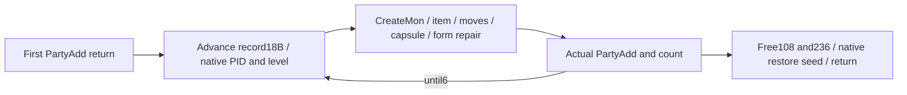

# Complete rematch constructor: six Pokémon, restored seed, closed lifetime

The finite EN/IT paths continue the same CPU/RAM after the
[first Pokémon](rematch-firstmon-source-rom-1.3.2.md), create the other five,
insert all six and return from the actual constructor. The independent oracle
checks every encrypted record, capsule seals, final original RNG seed, caller
registers, frees and unrelated RAM. The installed activation byte remains0;
active1 exists only in an explicitly named RAM fixture.

## Cosa farebbe un professionista di alto livello che non sto chiedendo

Follow the loop and teardown, not just the first successful insertion. Check
state carried between records, nonzero held items and capsules, all native
callee returns, the original two allocations and the real final seed store.
Require counterproofs where a correct six-member party survives a missing
restore or free. Keep native SDK internals distinct from modeled services.

The preceding source/build/readback qualifications remain separate results.
This case executes a complete constructor under initialized host conditions;
it does not prove natural phone/Dojo activation or a complete battle. Independent
review checks raw code/data, capsule bindings, persistent PID state, ABI and
false-green report cases.

## Il materiale più grezzo da cui partire

Use your own exact r4 EN/IT inputs, rematch objects and retained strategy object
prepared by the [inert](rematch-source-rom-1.3.2.md),
[active](rematch-active-source-rom-1.3.2.md),
[first-record](rematch-consumer-source-rom-1.3.2.md) and
[first-Pokémon](rematch-firstmon-source-rom-1.3.2.md) cases. They document patch,
retail→Plus1.1→V4→r4 provenance, headers/FAT/FNT/y9, compression/autoload,
owner composition, source recipe, flags and compiler authentication.

| Exact input | Size / SHA-256 |
| --- | --- |
| r4 EN |152786844B / `2e30d6960bb059615fca7527700d86f8282e82ccbe99bf62e22f027453dc3d3d`|
| r4 IT |159029760B / `13ebac02bdea3036511773587e6603ce6834e25f4b13d1a4662c3e954bfd5d4a`|
| Retained strategy `teams.o` |`e2429f61c7ee16071d303f7ca55cbb1553508720c6fe97b77aead9ce56e499e1`|

No compiler or ROM compositor runs in this continuation. Six retained recipe/source
hashes are checked before object reuse, so an old matching object cannot hide
current C/header/configuration or compiler-recipe source drift. Rematch/strategy ELF
and recipe data are re-attested against installed bytes. The owned post-form
50-byte recipe is checked again, including padding and all four incoming
callers/form setters. Archived Plus correspondence is not a fresh Plus build;
its historical compiler and the original native HGSS MW objects remain unavailable.

Semantic reference pin `cb614ad23449d5852b40321dc409c4143872b35c`:
[trainer_data.c](https://github.com/ctrl-cheeb-del/pokeheartgold/blob/cb614ad23449d5852b40321dc409c4143872b35c/src/trainer_data.c),
[pokemon.c](https://github.com/ctrl-cheeb-del/pokeheartgold/blob/cb614ad23449d5852b40321dc409c4143872b35c/src/pokemon.c),
[party.c](https://github.com/ctrl-cheeb-del/pokeheartgold/blob/cb614ad23449d5852b40321dc409c4143872b35c/src/party.c),
[filesystem.c](https://github.com/ctrl-cheeb-del/pokeheartgold/blob/cb614ad23449d5852b40321dc409c4143872b35c/src/filesystem.c),
[filesystem_files_def.h](https://github.com/ctrl-cheeb-del/pokeheartgold/blob/cb614ad23449d5852b40321dc409c4143872b35c/include/filesystem_files_def.h).
Native source correspondence is combined with raw instructions and actual
bounded execution; source names alone are insufficient attribution.

### Loop, persistent state and native ABI



The first receipt is deep-copied as Python evidence before continuation.
Registers and all4MiB main RAM are identical across that observer operation;
the receipt's canonical hash also remains unchanged after the full run.
Neither guest RAM nor the selected108-byte buffer is restored to preserve a report.

After the first return at `02073A68`, the native loop advances its record pointer
by18 bytes and returns to `0207397C`. Each record executes native class RNG,
level hook, CreateMon, held-item/four-move setters, capsule/form helpers, owned
post-form repair and actual PartyAdd. The next five CreateMon calls must have
R0=workspace, R1=expected species, R2=effective level, R3=IV31 and stack
`[1,expected_PID,2,0]`. Every helper must return with entry SP/R4–R11 preserved.

`pidGender` is initialized **once** at constructor `0207365A`, at frame SP+`7C`.
Record overrides mutate that same word; the loop does not initialize it again.
Trainer713's first override32 changes class value`78`→`79`; the five subsequent
override0 records keep`79`. Resetting the oracle per record would incorrectly
predict their PID, nature and ability. Raw override stores, source lifetime,
per-record pointer/before/after trace and final decrypted PID all verify this
link. This is an installed state dependency, not a newly implemented game fix.

The native final sequence is:

| Action | RAM PC | Physical r4 offset, EN/IT |
| --- | --- | --- |
| Advance record / loop |`02073A68..02073A82`|`00077A68..00077A82`|
| Free original108-byte buffer |`02073A84`|`00077A84`|
| Free original236-byte workspace |`02073A8A`|`00077A8A`|
| Call native SetLCRNGSeed with saved seed |`02073A90`|`00077A90`|
| Restore frame / return |`02073A94` / `02073A96`|`00077A94` / `00077A96`|

The saved seed comes from frame SP+`68`; the actual last seed store is native
`0201FD3A` to runtime `021D15A8`. No host reset is substituted. Constructor
SP returns to the original caller, with nonzero R8–R11 cookies preserved.
A separate fixture also initializes R4–R7 with nonzero cookies and requires their
return intact. This is an initialized ABI test, not a natural caller observation.

### Nonzero capsule provenance and model boundary

Capsule source IDs11 and12 are different from the stored flag: native
`SetTrMonCapsule` sets attribute162 to1 and attribute171 to24 bytes of seals.
Those bytes occupy decrypted party offsets76..99 (absolute Pokémon offset`D4`).
A flag-only oracle would miss an incorrect capsule.

Raw NARC_New code/pool `02007688..0200770C` SHA:
`98505a660741af0913067b1dcb9a7baad8ee8b5168fd8ec0d7ccfaac1571a530`.
Its pool at `02007708` points to path table `0210F210`; index185 at `0210F4F4`
points to `0210EC28`, string `a/1/8/5`. This follows the actual native pointer
binding, rather than guessing a path from the numerical ID. NARC ID185 is not
the NitroFS file ID314. Independent FNT/FAT/NARC reading finds one3072-byte member:
`8ef3070352d99143e8172c9f773a21b0e6c6f1b5a1256d442b551ed09c244a46`.
Its physical member offset is `045D823C` in both exact current inputs; the
verifier derives it through FAT/NARC rather than assuming that shared location.

| Capsule source | Member / offset / size | Slice SHA-256 |
| --- | --- | --- |
|11|0 /240 /24|`1876be303ff6bd3c3efcd950e6d1515dcfe0eb35f5395b1f8f3a04f342f0a79d`|
|12|0 /264 /24|`36faee5dd6285d8030f319b6d62397fc0e12c0ea2a5c287a9a6821132e623959`|

The native nonzero branch at `02072A56` opens185 on heap11. It passes a live
handle, member0, `(capsule_id−1)*24`, size24 and destination SP+8 as the fifth
argument to `NARC_ReadFromMember`, calls both native SetMonData setters and
deletes the handle. Actual caller PCs, arguments, exact slice/hash, destination,
setter input bytes and completed returns are checked.

NARC open/read/delete remain SDK models. Their handle is an opaque32-byte token;
the real NARC_New allocates84 bytes and has a native FS object layout. The model
does not reproduce that layout or execute SDK FS internals. No native instruction
may read token contents. Handle identity/lifetime, nontruncated slice bounds,
readonly source and return ABI are explicit model guarantees. Heap/name/archive
models retain the first case's bounds, canaries, freed-payload poisoning and
R1/R2/R3/R12 and NZCV poison test. R0 retains each modeled service result;
independence from unspecified R0 after void services remains a separate question. Model call counts do not measure real file I/O. Allocation/archive/name success
is modeled here; allocation and filesystem failure paths are outside coverage.

### Qualification and independent oracle

The [sparse manifest](../../features/rematch-variants/test/complete-qualification.json)
pins155 code blocks (2771 decoded PCs,6598 bytes) and76 disjoint readonly ranges
(470 bytes). Execution includes native routines, two owned post-form slices, thirteen
strategy code blocks and five archived Plus blocks. A sparse block can span the
adjacent native return and owned post-form entry. Owner boundaries remain exact.
High-address PCs are also checked against the independent strategy ELF/Plus code
mapping, rather than being classified as native HGSS. All fetch widths/ARM–Thumb modes and bytes are checked independently.
This is observed path coverage, not a full CFG or original native binary rebuild.
The reset-PID counter additionally admits the125-byte nature table only after
checking its pointer and all25×5 coefficients against the independent formula.

Raw personal/growth/learnset/move/name resources cover14 selected species. Every
modeled member has its own physical offset, size and SHA in the private report.
For all six members, the oracle recomputes class/personality/OTID RNG, quiescent header flags, decrypted
boxed checksum, species/item, ability/gender/form/nature, EXP/language, EV/IV,
name/EOS, moves/PP/PPUps, status/level/HP/all five stats and24 capsule bytes.
It separately requires six actual native copies/counts, post-form refreshes,
30 cleared PartyExtra bytes and unchanged two-byte tail padding.

A reconstructed heap/handle ledger checks every allocation/read/free/delete from
the service trace, as well as the actual final empty ledgers. The first two
allocations must be released exactly at the declared final callers. Only owned
stack/workspace/enemy-party/heap regions, growth cache, the precise Plus hit
counter and native seed stores may change. The player party, other parties,
settings and all remaining RAM stay frozen. No save is used or written.

## I metodi e gli strumenti da usare

Use the [pinned dependencies](../../requirements.txt), private exact ROMs and
objects produced by the preceding cases. This verifier does not invoke a compiler.
From repository root:

```sh
python source/features/rematch-variants/tools/attribuisci_squadra_completa.py \
  --rom /private-inputs/r4-EN.nds --language EN \
  --objects /private-results/rematch-EN-build \
  --strategy-object /private-results/consumer-EN-build/teams.o \
  --json /private-results/complete-EN.json.gz
```

Repeat with IT. Outputs must be new, outside `source` and retained rematch
objects. Reports use compact JSON; `.gz` selects deterministic gzip with no
personal filename or timestamp. Keep reports private: they contain raw memory.
Store argv, exit code, hashes, source snapshots and OS resource receipts. Exit0
qualifies this finite suite; exit2 is a validation refusal. Bound each run to
180s/1GiB RSS/2MiB log/16MiB report and keep10GiB disk headroom. The guest bound
is3million instructions/512-byte observed stack, justified by six full bodies.
These bounds and host timings are not hardware performance claims.

```sh
PYTHONPATH=source SGP_R4_ROM_DIR=/private-inputs \
  SGP_REMATCH_OBJECTS_DIR=/private-results/rematch-EN-build \
  SGP_STRATEGY_OBJECT=/private-results/consumer-EN-build/teams.o \
  python source/features/rematch-variants/test/test_complete_attribution.py
```

All ten methods are covered without skips by the bounded suite and follow-up
oracle/source-admission checks. The [tests](../../features/rematch-variants/test/test_complete_attribution.py)
include four ROM-free CLI/source-admission methods and six methods requiring both exact ROMs
and retained objects. Missing inputs cause explicit skips, not acceptance.
Default names are `r4-EN.nds`/`r4-IT.nds`, configurable with one `%s` in
`SGP_R4_ROM_NOME`. Later-member mutations are re-sealed with valid checksums and
consistent decoder output, so a correct first slot or mere checksum cannot pass. A separate header-lock mutation retains a valid checksum
and consistent PartyAdd copy hashes. It passes the deliberately weakened oracle
without the quiescent-flags predicate and fails the complete oracle.

The [stage reader](../../features/rematch-variants/tools/rileggi_stadi.py) adds
`--complete` for231 sparse windows across your exact retail/base/V4/r4 inputs.
Use the preceding lineage command with this flag and a fresh output. It compares
exact addresses without normalization. `--firstmon` and `--complete` are mutually
exclusive; the default eleven-window mode remains available. The current inputs match all231 windows; V4 matches229, with two changed
post-form slices. EN retail/base and IT base have198 matches and30 unmapped
windows; retail IT has182 matches and30 unmapped windows. Absent mappings are
not zero padding. Regional pointer and data differences are not a general
relocation or semantic-change claim. The earlier default and first-Pokémon
reader outputs remain identical.

### Counterproofs, results and remaining links

Each language verifies four selected complete parties, four counterproofs and
two neutral guards. All six native creations, inserts, both original frees,
final seed restore and constructor return are required. The owned rematch,
strategy and post-form provenance remain distinct from archived Plus code and
native source correspondence. Targeted semantic agreement is finite.

The wrong-restore counter changes only the actual native setter's R0 at the final
call: six Pokémon stay identical, but the original seed is wrong. Skipping exactly
the first final free preserves party/seed but leaves108 bytes live. A wrong,
valid capsule slice preserves species/stats/flag and final seed but changes24
seals. Resetting persistent PID state before record2 preserves the chosen buffer,
six-count and final seed while changing the later identities. Relabeling any
counter normal must still fail. SDK poison and nonzero caller-cookie fixtures
must preserve the exact six encrypted records and final seed.

The small first-observer extension uses default instruction-limit/stop attributes;
all18 preceding first-Pokémon CPU receipts remain identical under those defaults.
The name model correction belongs to the preceding case and changes no game code.

No natural phone/Dojo activation, other trainer formats, arbitrary overrides/forms,
complete battles, original MW rebuild, native SDK FS execution, raw SAVE/cold/device
or hardware speedup is established. The installed activation stays0. No gameplay
repair or optimization is implemented. Subsequent attribution must identify a new
finite caller/state question rather than re-running these completed paths.
