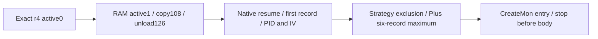

# Rematch buffer to the first native CreateMon call

The exact r4 EN/IT constructor consumes the party selected by the
[active RAM case](rematch-active-source-rom-1.3.2.md), executes native personality
RNG/IV arithmetic and the chained level hook, and reaches the first `CreateMon`
entry with the expected eight arguments. Execution stops **before its body**.
The installed ROM remains active0; the active path is a named RAM fixture.

## Cosa farebbe un professionista di alto livello che non sto chiedendo

Follow the actual chosen buffer after overlay126 is unloaded. Prove that the
first record, native RNG, strategy exclusion and Plus level calculation all
contribute the expected values. Check complete helper returns, state writes,
register/stack ABI and data reads, including all six opponent levels. Separate
a successful call boundary from the Pokémon that a later body might construct.

The independent review checked the raw callers and source, repeated an IT
positive and both consumer counterproofs without compiling, and rejected a
forged level-table observation. Matching source names are supporting evidence;
source compilation, exact installed bytes and initialized guest execution are
separate qualifications throughout this case.

## Il materiale più grezzo da cui partire

Use the r4 ROMs and rematch objects identified in the
[inert case](rematch-source-rom-1.3.2.md) and
[active continuation](rematch-active-source-rom-1.3.2.md). Those pages provide
retail/Plus1.1/V4/r4 size, language, revision, SHA-256, composition, FAT/FNT/y9,
overlay compression and local-object preparation. This continuation additionally
compiles the existing [trainer-strategy owner](../../features/trainer-strategy/README.md).
No ROM composition or installation occurs.

| Exact current input | SHA-256 |
| --- | --- |
| r4 EN,152786844B | `2e30d6960bb059615fca7527700d86f8282e82ccbe99bf62e22f027453dc3d3d` |
| r4 IT,159029760B | `13ebac02bdea3036511773587e6603ce6834e25f4b13d1a4662c3e954bfd5d4a` |

The reference constructor and eight-argument API are available in the pinned
[trainer_data.c](https://github.com/ctrl-cheeb-del/pokeheartgold/blob/cb614ad23449d5852b40321dc409c4143872b35c/src/trainer_data.c)
and [pokemon.c](https://github.com/ctrl-cheeb-del/pokeheartgold/blob/cb614ad23449d5852b40321dc409c4143872b35c/src/pokemon.c).
Their raw files match the clean local reference at that commit. This identifies
source correspondence, not an original HGSS MW binary reconstruction.
The original native compiler/objects are unavailable.

### Owned dependency and inherited code

[teams.py](../../sgp13/teams.py) compiles
[native.c](../../features/trainer-strategy/native.c),
[strategy.c](../../features/trainer-strategy/strategy.c) and
[strategy.h](../../features/trainer-strategy/strategy.h) with the same authenticated
Apple clang21.0.0 `(clang-2100.4.1.1)` as the rematch case. The existing ARM946E-S
Thumb/`-Os` freestanding flags and production ELF loader are reused. The retained
`teams.o` is independently parsed for internal relocations, entries and repeated
code/data mapping symbols. The resulting580B exactly match RAM `023D6000`:
`09e88a137b006e8ba638770ba57e1a6e5fe9960787e05ec7c253cb230da04436`.

A bounded raw-NARC adapter rebuilds the192B configuration from the seven
[declared source records](../../sgp13/data/strategic-teams.json), checking header,
party SHA and every move preimage. With320B zero configuration padding it matches
`023D6600..023D6800`, SHA
`003ec5b4372e8b0070f2521d1676a8038d19b4b472218aadedb4735c0bb27114`.
IDs are21/31/32/33/34/244/245. Source recipe reserves1536B for code and512B for
configuration; this reconstruction checks the580B payload and full512B config.
It makes no code-padding reclamation claim.

The inherited [Plus blob manifest](../../sgp12/build/plus/manifesto.json),
[Plus source](../../features/native-core/sorgenti-v-finale/plus_party.c) and
[installer](../../sgp12/blocchi/plus_chunk.py) provide the other dependency.
Current256B blob SHA `6392b5b8a1e67727ec4ea2af7ea8ee4f29219fb3161f8f9b8b0fae2d96216b56`
and256B trainer table SHA `dcbcaf243fbe29c5b8eced0b0102bddf034fde66977912d32da28484fc42144e`
match the archived artifacts exactly. Their recorded compiler is the earlier
`clang-2100.3.34.2`: this is archived binary correspondence plus source
correspondence, not a fresh Plus rebuild.

| Span | RAM | Physical ROM, both current languages |
| --- | --- | --- |
| Seam resume | `0207363E` | `0007763E` |
| Type3 level BL | `02073A0C` | `00077A0C` |
| CreateMon entry pin32B | `0206DE38` | `00071E38` |
| Native LCRNG36B | `0201FD44` | `00023D44` |
| Native signed divider524B | `020F2998` | `000F6998` |
| Strategy code580B | `023D6000` | `001258C0` |
| Strategy config512B | `023D6600` | `00125EC0` |
| Plus blob256B | `023D8100` | `001279C0` |
| Trainer-level table256B | `023D8500` | `00127DC0` |

These are independent ARM9 section readbacks, not a formula for compressed
components. Runtime seed `021D15A8` is initialized by the actual native setter;
it is not attributed to a stored ROM seed value.

### Execution, ABI and resources



The same Unicorn instance executes the qualified rematch prefix. A complete
CPU context is saved at `0207363E`; the existing bench's post-getter is shown to
leave all4MiB main RAM unchanged. Only that CPU context is restored before
continuing. The chosen buffer and heap/stack memory are not replaced. Module126
is already unloaded and diagnostically poisoned; no late call into it is admitted.

The constructor's type3 switch reads its actual table, then the first record's
species/form, override, difficulty and base level. Native class lookup uses
header class66/67 and the corresponding table bytes. Covered override paths
have no gender-ratio override; normal first records exercise0/32 and counters
also exercise16. The native setter and LCRNG execute the personality sequence;
the524B signed ARM divider executes `(difficulty*31)/255`, yielding IV31 here.
Every RNG transition/high16 return, helper return SP/R4–R11 and seed store is
checked. The original global seed is **not restored at this boundary**; that
occurs later at constructor return, outside this case.

The four-byte level BL at `02073A0C` reaches `strategy_hook=023D6229`, then
`strategy_native=023D61C5` and `strategy_apply=023D602D`. Actual core arguments
are `(buffer,trainer,0x603,1)` with configuration `023D6600` on the stack. The
trace reads all seven IDs at PC `023D6086`, finds neither712 nor713, returns0
and leaves the chosen buffer unchanged. This qualifies these two exclusions,
not the seven active trainer modifications.

The hook then tail-jumps into the inherited `sgp_trainer_hook=023D8195`, which
calls level code `023D8134`. Its group-max call is `(buffer,18,6)` and actually
reads both level bytes of all six **opponent records**. Their maximum is72;
lookup `023D8548` is81. With Plus enabled and cap100, base68→77 and base70→79.
This calculation does not use player-party levels. The fixture's initialized
parties and cap do not establish natural player state.

The strategy/Plus hook preserves species, shifted IV, R4–R11/SP and the native
flag-setting result; it changes effective level and supplies workspace R0.
At the first `CreateMon` call: R0=236B workspace, R1=first species, R2=effective
level, R3=IV; stack=`[1,derived_PID,2,0]`, SP=host-seam SP and LR=`02073A17`.
The callee entry is pinned but its first instruction is not executed.
Held-item/move/PP setters begin later (`02073A1E`/`02073A32`); they are untested here.

Code guards admit12 pinned native instruction blocks, independently mapped
strategy ELF code and three Plus code islands. The switch table `02073672`,
species pool `02073994`, strategy pool `023D6240` and Plus pool `023D818C` are
excluded from instruction fetch. Reads and stores have separate resource bounds;
only native stack, seed and the exact Plus hit-counter store may change in the
consumer phase. Canaries, unrelated RAM, chosen-buffer identity and completed
helper calls are checked independently.

## I metodi e gli strumenti da usare

Use the [pinned dependencies](../../requirements.txt), exact Apple compiler and
private rematch objects prepared by the inert case. The compiler authenticator
requires the qualified macOS toolchain; another compiler is a separate rebuild
question. From repository root:

```sh
python source/features/rematch-variants/tools/attribuisci_consumo.py \
  --rom /private-inputs/r4-EN.nds --language EN \
  --objects /private-results/rematch-EN-build \
  --work /private-results/consumer-EN-build \
  --json /private-results/consumer-EN.json
```

Repeat with the matching IT input. Work and JSON must be new, outside `source`
and the retained input objects; JSON must be outside work. Exit0 qualifies this
bounded case; exit2 is a validation refusal. Store argv, exit code, source hashes,
objects, JSON and OS resource receipts privately. No complete ROM, extracted
retail member, save, BIOS or raw memory dump belongs in the public tree.

```sh
PYTHONPATH=source SGP_R4_ROM_DIR=/private-inputs \
  SGP_REMATCH_OBJECTS_DIR=/private-results/rematch-EN-build \
  SGP_STRATEGY_OBJECT=/private-results/consumer-EN-build/teams.o \
  python source/features/rematch-variants/test/test_consumer_attribution.py
```

The [seven tests](../../features/rematch-variants/test/test_consumer_attribution.py)
include two ROM-free CLI methods and five methods requiring both exact ROMs,
rematch objects and `teams.o`. Qualified run: all seven methods, no skips. Missing
private inputs produce explicit skips, not runtime acceptance. ROM names default
to `r4-EN.nds`/`r4-IT.nds`, configurable with one `%s` in `SGP_R4_ROM_NOME`.

### Incremental lineage

The [read-only stage reader](../../features/rematch-variants/tools/rileggi_stadi.py)
compares eleven dependency windows across the exact four inputs:

```sh
python source/features/rematch-variants/tools/rileggi_stadi.py \
  --rom /private-inputs/r4-EN.nds --v4 /private-inputs/v4-EN.nds \
  --base /private-inputs/plus-1.1-en.nds --retail /private-inputs/retail-EN.nds \
  --language EN --json /private-results/consumer-lineage-EN.json
```

Run IT with corresponding inputs. V4→r4 leaves all eleven windows identical;
retail/Plus1.1 lack the mapped strategy/Plus owner regions. The seven native
windows match r4 in EN and base/V4/current IT. Retail IT has four named literal
fields: class-table pointer differs by88hex, seed pointers by60hex. Original
bytes remain untouched; only temporary comparison copies substitute each exact
field. Getter/setter/LCG agree on the seed address within each input, and covered
class entries agree. This does not establish a general BSS or language relocation.
Constructor/seam lineage remains covered by the inert case.

### Result, counterproofs and limits

Each language executes four positives (two trainers × two selection seeds) and
eight counterproofs. The wrong-record shadow advances only the local record
pointer by18B: full chosen-buffer identity/workspace/registry survive, but native
reads and CreateMon species/PID are wrong. The cap75 shadow preserves buffer,
species, IV, personality and RNG but changes effective level. Both are rejected
even when renamed normal. Neither shadow changes the installed game.

Owned rematch reconstruction is inherited; strategy580B/config512B reconstruction
is new. Archived Plus correspondence is distinguished from fresh compilation.
Native first-record consumption and targeted semantic agreement are observed
under initialized active RAM; natural activation remains unobserved. No full
CreateMon body, Pokémon/party completion, item/PP application, constructor seed
restoration, original MW rebuild, SAVE/cold/device or hardware performance is
claimed. Maximum observed stack360B is below the512B oracle bound; instruction
budget is200000. No new game repair or optimization is implemented.
