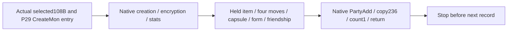

# First rematch Pokémon: native creation through PartyAdd

The exact r4 EN/IT ROMs execute the first `CreateMon` body, held-item setter,
four move setters, capsule/form helpers, the Plus post-form repair and the first `Party_AddMon`
return. The encrypted236-byte workspace and actual first party slot agree with
an independent source/resource oracle. This continues the
[first-record case](rematch-consumer-source-rom-1.3.2.md) in the same CPU and RAM.
The installed activation byte remains0; active1 is an explicitly named RAM fixture.

## Cosa farebbe un professionista di alto livello che non sto chiedendo

Verify the complete boundary rather than inferring a completed Pokémon from
callee-entry arguments. Distinguish native HGSS code from compiled Plus owners,
SDK models and raw archive data. Check caller/return ABI, instruction/data
separation, encrypted checksum, resource-derived values, allocation lifetime,
actual party insertion and counterproofs with identical final output.

Independent review examined the raw instructions, reference source, sparse
code/data manifest, oracle and model boundaries. The native HGSS source is a
semantic reference, not a fresh original MW binary reconstruction. Existing
rematch/strategy source-to-object reconstruction remains the qualification of
the preceding cases. No game behavior is changed by this verifier.

## Il materiale più grezzo da cui partire

Use your own private exact inputs and retained objects prepared by the
[inert case](rematch-source-rom-1.3.2.md),
[active RAM case](rematch-active-source-rom-1.3.2.md) and
[strategy reconstruction](rematch-consumer-source-rom-1.3.2.md).
These pages identify retail→Plus1.1→V4→r4, patches, sizes, language/revision,
FNT/FAT/y9, compression, autoload, owner composition, flags and toolchain.
This continuation performs no compilation or ROM composition.

| Input | Size / SHA-256 |
| --- | --- |
| r4 EN |152786844B / `2e30d6960bb059615fca7527700d86f8282e82ccbe99bf62e22f027453dc3d3d`|
| r4 IT |159029760B / `13ebac02bdea3036511773587e6603ce6834e25f4b13d1a4662c3e954bfd5d4a`|
| Retained strategy `teams.o` |`e2429f61c7ee16071d303f7ca55cbb1553508720c6fe97b77aead9ce56e499e1`|

The rematch objects are independently linked/read back again. The retained
strategy ELF is parsed again against its580 installed bytes; its192-byte recipe
is rebuilt from authenticated header/party preimages and checked with320-byte
padding. Generate that object using the preceding case's authenticated compiler,
not an arbitrary substitute. The inherited Plus code/table remain archived
correspondence with their historical compiler unavailable. The original native
HGSS compiler and object files are also unavailable.

The semantic reference is pinned to `cb614ad23449d5852b40321dc409c4143872b35c`:
[pokemon.c](https://github.com/ctrl-cheeb-del/pokeheartgold/blob/cb614ad23449d5852b40321dc409c4143872b35c/src/pokemon.c),
[trainer_data.c](https://github.com/ctrl-cheeb-del/pokeheartgold/blob/cb614ad23449d5852b40321dc409c4143872b35c/src/trainer_data.c),
[party.c](https://github.com/ctrl-cheeb-del/pokeheartgold/blob/cb614ad23449d5852b40321dc409c4143872b35c/src/party.c),
[pm_string.c](https://github.com/ctrl-cheeb-del/pokeheartgold/blob/cb614ad23449d5852b40321dc409c4143872b35c/src/pm_string.c).
Names and source similarity support correspondence; raw caller instructions and
bounded execution provide the separate execution evidence.

### Native boundaries and resources

| Boundary | Loaded RAM | Physical r4 offset, both languages |
| --- | --- | --- |
| CreateMon body |`0206DE38`|`00071E38`|
| CreateBoxMon |`0206DED0`|`00071ED0`|
| SetMonData, held attribute6 / form112 |`0206EC40`|`00072C40`|
| MonSetMoveInSlot |`020714E8`|`000754E8`|
| Capsule helper |`02072A44`|`00076A44`|
| Plus post-form helper50B |`02073AE4`|`00077AE4`|
| Party_AddMon |`02074524`|`00078524`|
| Stop before next instruction |`02073A68`|`00077A68`|

These addresses belong to the loaded ARM9 sections. The verifier independently
reads all qualified ranges through the raw ARM9 reader, reporting physical
locations and SHA-256. The table is not a mapping rule for compressed overlays.
Module126 is already unloaded and poisoned before this continuation; its
lifetime and WFC/loader call chain remain covered by the inert/active cases.
Runtime seed `021D15A8` and growth cache `021D421C` are RAM state, not stored ROM
values. Growth-cache writes occur only in the declared archive model.

Raw readonly resources are NARC2 `a/0/0/2` (personal44B), NARC3 `a/0/0/3`
(growth404B), NARC11 `a/0/1/1` (move16B), NARC33 `a/0/3/3` (learnset) and
message bank237 in `a/0/2/7` (species names). The report records archive identities
and every modeled member's size, SHA and physical member offset, including
moves learned by the native default-moveset path before replacement.
Fixtures remain private; no extracted member is shipped with the tool.

### Execution and ABI



The observer at the P29 boundary preserves all CPU registers and all4MiB main
RAM. Only its Python evidence objects are deep-copied before continuation:
SDK logs from the later body must not retroactively alter the earlier receipt.
The actual chosen buffer, workspace, stack and CPU are retained.

`CreateMon` receives R0=workspace, R1=species, R2=effective level, R3=IV31;
stack=`[1,fixed_PID,2,0]`. Fixed PID/IV avoid their random-generation branches.
OT type2 executes actual native LCRNG calls. Raw `0206DF0E` supplies the low16
bits, `0206DF14` the high16; the native XOR comparison rerolls if below8.
The independent oracle advances the same mathematical LCG until non-shiny and
checks every observed draw, order, return and global seed store. The four
covered records take two draws each; this is not a universal fixed draw count.
Local encryption streams are distinct from this global RNG. Original constructor
seed restoration occurs later and is outside this boundary.

The fifty-byte helper at `02073AE4` is an owned fixed-byte recipe in
[trainer_fixes.py](../../sgp131/trainer_fixes.py), not the original native
Frustration helper. The composer applies this `trainer-fixes` stage to V4 while
keeping four form-setter sites and four callers unchanged. Before SHA:
`313e9e41edd7d3527070155115ea76c4726786a72ee96faba9d5df6ccb3b7574`;
after SHA:
`219412a0140b9076f367d53bb22bc0a80ddc1806d68d99f3a9a8f1b9e89de2e3`.
It has46B instructions plus4B NOP padding. No compiler is involved in this
recipe. The verifier checks all50B and independently decodes its four BL targets:
UpdateMonAbility `020722D4`, CalcMonStats `0206E250`, MonHasMove `02071754` and
SetMonData `0206EC40`. It observes all four complete native callee returns,
checks the Frustration218 query and friendship attribute9/value255. Matching
form0 output alone would not prove that the refresh calls actually executed.
The new lineage check exposed and corrected the preliminary native-only label.

Caller BLs at `02073A1E`, `02073A32`, `02073A4A`, `02073A54`, `02073A5A` and
`02073A64` reach the actual helpers. Held-item arguments are `(workspace,6,
record+6)`. Four move calls use `(workspace,move,slot)` for slots0..3. Capsule0
takes its native early return; form attribute112 is set to0. The owned post-form repair refreshes ability/stats, then friendship becomes
255 because none of the four selected moves is Frustration218. PartyAdd receives
`(actual_opponent_party,workspace)`, copies236 bytes, clears the first extra
record, increments count0→1 and returns BOOL1. Every tracked helper completes
with its entry SP/R4–R11 preserved before the stop at `02073A68`.

The oracle decrypts128 boxed bytes using checksum, unshuffles four32-byte blocks
using PID, recomputes the64-halfword checksum and decrypts100 party bytes using
PID. It checks species/item, OTID, EXP, internal language, friendship/ability,
EV/IV, four moves/PP/PPUps, gender/form/nature, nickname/EOS, level, status,
current/max HP and all five other stats. EXP comes from the raw growth member,
PP from raw move records, ability/gender/stats from raw personal bytes. Nature
uses integer floors and the native unsigned16 intermediate. The workspace and
actual slot must also be byte-identical, with header `[6,1]` and a real add return.

Both current ROMs have native game-version7/language2 bytes here. These are
separate from the ROM's authenticated language and localized message archive;
the verifier reads them instead of inventing an IT language-field value.

### Qualification and SDK boundary

The [sparse manifest](../../features/rematch-variants/test/firstmon-qualification.json)
pins138 code blocks (136 native and two executed slices of the owned post-form recipe) (5814B,2425 decoded instruction PCs) and58 separate
readonly ranges (361B). Capstone independently checks instruction widths and
ARM/Thumb mode. Runtime fetches outside this map, literal-pool execution and
unexpected reads/stores are refused. This map covers observed paths, not whole
functions or a complete CFG. The wrong-move control adds valid native branches;
its two instruction-replacement controls never supply normal admission bytes.

Heap allocation/free, whole-member archive reads and species-name acquisition
are explicit SDK models. Allocation sizes, destinations, raw payload hashes,
return SP/R4–R11, canaries, single free and subsequent reads are checked. Freed
payloads are poisoned. Guest reads may not touch dead allocations or canaries.
No opaque NARC handle, nonzero capsule, overlay FS or unknown SDK entry is admitted
in this phase. A first Fearow body uses72 modeled services, including38 raw
member reads; these counts are fixture-specific, not an allocator timing claim.

The name model was corrected during this qualification: native String size
excludes EOS, capacity includes it, and allocation includes one spare u16.
The native copy reads `size+1` words. An EOS-inclusive size copied poisoned spare
data into nickname padding even when the displayed name looked correct.
[Dedicated tests](../../features/rematch-variants/test/test_species_string.py)
exercise native copies for lengths0/6/10 in both exact ROMs and demonstrate the
old-header failure. This changes the developer bench, not game code or ROM bytes.
All24 preceding P29 CPU receipts remain identical after the model correction.

Only stack512B, workspace236B, actual count/first slot, first five extra bytes,
live model allocations and the exact RNG store can change. The other party
slots and unrelated RAM remain frozen. The native five-byte extra clear uses a
final16-bit read/modify/write: a separate fixture initializes the neighboring
byte to `7B` and verifies it survives. A physical store width of six bytes does
not grant ownership of the neighbor.

## I metodi e gli strumenti da usare

Use the [pinned Python dependencies](../../requirements.txt). Prepare the rematch
objects and strategy object with the preceding cases; this tool reuses them and
never launches a compiler. From repository root:

```sh
python source/features/rematch-variants/tools/attribuisci_primo_mon.py \
  --rom /private-inputs/r4-EN.nds --language EN \
  --objects /private-results/rematch-EN-build \
  --strategy-object /private-results/consumer-EN-build/teams.o \
  --json /private-results/firstmon-EN.json.gz
```

Repeat with the exact IT ROM. Output must be new, outside `source` and retained
rematch objects. `.gz` selects deterministic gzip without path or timestamp in
its header. Plain JSON is also supported. Reports contain private raw memory:
keep them local. Exit0 means the finite suite passed; exit2 is a validation
refusal. Preserve argv, exit code, hashes, objects and resource receipts privately.
Bound runs to180s/1GiB RSS/2MiB log/16MiB output and keep10GiB disk headroom.
The guest limit is500000 instructions and512B observed stack; these are
verification limits, not native performance measurements.

```sh
PYTHONPATH=source SGP_R4_ROM_DIR=/private-inputs \
  SGP_REMATCH_OBJECTS_DIR=/private-results/rematch-EN-build \
  SGP_STRATEGY_OBJECT=/private-results/consumer-EN-build/teams.o \
  python source/features/rematch-variants/test/test_firstmon_attribution.py
```

The [nine tests](../../features/rematch-variants/test/test_firstmon_attribution.py)
include three ROM-free CLI methods and six methods requiring both ROMs/objects.
The qualified run has no skips. Missing private inputs cause explicit skips,
not runtime acceptance. Default names are `r4-EN.nds`/`r4-IT.nds`, configurable
with one `%s` in `SGP_R4_ROM_NOME`. Tests re-seal modified encrypted records with
valid checksums and consistent reported decoder/party copies: OTID, EXP, PP,
IV, name, HP and stat mistakes must still fail the independent semantic oracle.

The196-window lineage comparison finds194 matches in EN retail/base/V4 and IT
base/V4: the two changed code slices are the owned post-form replacement.
Retail IT has183 matches at these exact addresses; additional differences are
named literal/data windows, including regional pointers. This is an exact-address
comparison, not evidence of changed nature semantics at relocated tables.
V4→r4 full50B preimage/replacement additionally match the owner recipe in both
languages. The default eleven-window reader output remains identical to P29.

The [stage reader](../../features/rematch-variants/tools/rileggi_stadi.py) accepts
`--firstmon` to compare all196 sparse code/data windows across your four exact
retail/base/V4/r4 inputs. Use the preceding case's lineage command with that flag
and a fresh output. It records exact differences without normalization; it does
not execute historical inputs or establish general regional relocation.

### Results, counterproofs and remaining links

Each language runs four normal records, three counterproofs, SDK volatile poison
and the adjacent-byte guard. Normal selected species are Fearow22/Crobat169 for
trainer712 and Yanmega469 for trainer713; levels77/79, IV31, held item0, form0,
capsule0 and friendship255. Both713 variants have the same identity/statistics
but a different first move. These facts cover these records and initialized seeds.

The wrong-fourth-move control preserves the chosen108-byte source buffer but
changes slot3 in the actual native setter. Skipping PartyAdd preserves a correct
workspace while leaving party count0. Skipping the zero held-item setter leaves
the **entire final Mon/party/RNG output identical**: only the required native
caller/return trace detects the missing attribution link. All three fail even
when relabeled normal. Poisoning SDK volatile registers and NZCV preserves exact
Mon/party/RNG output; it checks calling-convention dependence, not SDK internals.

Documented source provenance, owned rematch/strategy reconstruction, the post-form
recipe, archived Plus correspondence and bounded native activation are separate results. Native semantic agreement is demonstrated for
these finite records; no full native binary rebuild or universal equivalence is
claimed. The second Pokémon, complete party, constructor return/original seed
restoration, natural phone/Dojo activation, nonzero item/capsule/form, raw SAVE,
cold restart, device and hardware timing remain outside coverage. Existing game
issues are not repaired. The next executable link is the full constructor and
its final seed/lifetime boundary.
