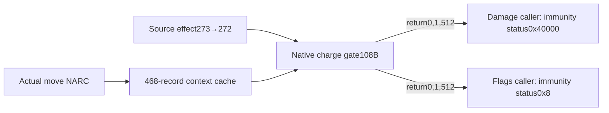

# Wonder Guard: source effect gate and the two exact current consumers

The one-byte HG-B01 repair reconstructs the complete108-byte native gate in
exact r4 EN/IT. Current move data, both native callers and explicit charge
states are verified through20 positive and8 counter/control entries per
language. This attributes an existing repair; it changes no game code or saves.

See the [owner](../../features/type-consumers/README.md),
[Grounding case](grounding-source-rom-1.3.2.md),
[flags composition](fairy-flags-source-rom-1.3.2.md) and
[source-to-ROM method](../test-bench.md#linking-source-to-an-exact-rom).



## Cosa farebbe un professionista di alto livello che non sto chiedendo

Identify the real effect owners instead of inferring them from move names.
Follow source halfword→complete gate→actual context data→both callers and their
different status encodings. Preserve charge/impact behavior and the branch;
a Fire Fang-only positive cannot detect an incomplete unconditional-branch fix.

Keep older evidence attached to its original inputs. The historical private
campaign executed512 calls on eight earlier Plus images, with source and result
hashes revalidated here. It is retained, not repeated or relabelled as r4.
This case adds current-image readback, current data/ABI closure and a public
reproducer. Independent Sol6.1 review read all eight current input-role images,
checked data and selected IT positive/counterexample executions independently.

## Il materiale più grezzo da cui partire

Supply your own exact retail revision0, Plus1.1, V1.3 V4 and r4 EN/IT. Input
preparation and complete identities are linked in the
[flags input section](fairy-flags-source-rom-1.3.2.md#il-materiale-più-grezzo-da-cui-partire),
[`baseline.py`](../../sgp131/baseline.py) and
[r4 contract](../../distribution/game-1.3.2-r4.json). Every run authenticates
all four complete files per language. No BIOS, save, ROM, retail dump or
extracted asset is distributed with this case.

The owner is [`type_consumers.py`](../../sgp131/type_consumers.py),
`FIRE_FANG_PREIMAGE`, `FIRE_FANG_REPLACEMENT`, the guarded context and branch.
The [shared AI composition](../../sgp131/mechanics_stages.py) writes the edit
into decoded overlay12. No new payload is compiled: a halfword in inherited
native code changes, with one byte actually different. The original native MW
compiler and complete native source reconstruction are not claimed.

At pret/pokeheartgold commit`cb614ad23449d5852b40321dc409c4143872b35c`,
`src/battle/battle_util.c::CheckChargeMoveHitTurn` explains the gate and its
callers `BattleSystem_ApplyTypeEffectiveness`/`CalcTypeEffectivenessFlags`.
Raw instructions, context offsets and current record data verify that
correspondence independently of the function names.

## I metodi e gli strumenti da usare

Dependencies match the preceding qualified tools: Python3.14.7, ndspy4.2.0,
Capstone5.0.9 and Unicorn2.1.4 in the recorded run. No compiler, full ROM build
or emulator capture is needed. Set private input/report variables, then run
using the dependency environment's Python:

```sh
python3 source/features/type-consumers/tools/attribuisci_wonder_guard.py --language EN \
  --rom "$R4_EN" --v4 "$V4_EN" --base "$BASE11_EN" --retail "$RETAIL_EN" \
  --json "$CASE/wonder-EN.json"
python3 source/features/type-consumers/tools/attribuisci_wonder_guard.py --language IT \
  --rom "$R4_IT" --v4 "$V4_IT" --base "$BASE11_IT" --retail "$RETAIL_IT" \
  --json "$CASE/wonder-IT.json"
SGP_R4_ROM_DIR="$R4_DIR" SGP_R4_ROM_NOME='r4-%s.nds' PYTHONPATH=source \
  python3 -m unittest sgp131.test_fairy_ai_rom.CurrentCompositeWonderGuard -v
```

Missing private unit inputs explicitly skip. The CLI cannot replace an input
with its report. Reports retain mappings, hashes, synthetic state, actual data
reads and ABI observations; they do not emit record or instruction dumps.

### Source recipe, insertion and native bytes

| Material | RAM / extent | Evidence |
| --- | --- | --- |
| Charge gate | `02258440–022584AC`,108 B |98 B code,2 B alignment,8 B literal pool |
| Source-owned halfword | `0225848C`,2 B | `adds r2,#0x11`→`adds r2,#0x10`, effect273→272 |
| Retained BNE | `02258490`→`0225849E` | Actual branch decoded and unchanged |
| Effect-data alias | LDR`02258444`→pool`022584A4` | Literal`0x3DE`; reads16-bit effect at ctx+3DE+move*16 |
| Battle-status alias | LDR`02258492`→pool`022584A8` | Literal`0x213C`; charge-hit bit`0x200` |
| Native callers | `02251F64`, `0225214A` | Damage and flags consumers respectively |

Complete old gate SHA-256 in retail/base11/V4 EN/IT is
`1d833b36828c4421006a0e6ef5a3843420c62ae19c075823c4f45e1d91457a42`;
current r4 gate SHA-256 is
`acc3b85b54aba24a607d4130b98a5e2fe07caf235a3cb2b933173fe8734b6b9e`.
Applying only the declared source halfword to V4 reconstructs all108 bytes;
only byte`0225848C` changes. The branch and remaining code/data are preserved.
Retail IT's gate address is`022583E0`; its PC-relative code and integer offset
literals have the same old108 bytes. No runtime address normalization occurs.

The gate is in compressed overlay12, file12, decoded base`022378C0`,226176 B,
BSS0. Current FAT spans are EN`08314200–0833B940`, IT`08800000–08827740`,161600 B.
Raw y9/FAT plus independent project/ndspy BLZ reads record stored/decompressed
identities and footer. Decoded instruction positions are not simple physical
`FAT start + RAM offset` addresses. ARM9/autoload and overlay18 identities are
recorded separately, reusing the preceding readers.

The damage parent, Grounding, multiplier and real signed arithmetic retain
[P14's qualified windows](grounding-source-rom-1.3.2.md). The flags consumer
retains [P10's final452-byte composition](fairy-flags-source-rom-1.3.2.md),
including Fairy helper148 B, corrected loop backedge and HG-B13 combiner mask.
It is not the historical campaign's earlier composition.

### Actual archive and context data

Raw FNT/FAT selects `a/0/1/1`, file140, physical`01093800–0109645C` in current
EN/IT. The reused independent NARC reader checks member extents against ndspy.
Archive SHA-256 is
`beed8ddf861e575b9c38dfa65a6c0c51fb237305ddd73c393f5e2009fbc75260`.
There are471 members, all16 B;468 is the battle-cache prefix, not the archive
member count. Scanning all471 identifies effect273 only in Fire Fang424 and
272 only in Shadow Force467.

Fire Fang's record has power65/type10; Shadow Force has power120/type7.
Selected member hashes and physical positions are in the report. The injected
468-record context cache is7488 B, SHA-256
`c64da77ab5f1158520a0f17905d457f3104c32aae1513c622cec0daa9f3e1588`.
The CPU constructor binds this identity as well as size. The exact prefix is
copied into synthetic ctx+`3DE` before snapshots. Its unchanged post-execution
hash and context comparisons protect the input; no native cache loader,
allocation or natural cache lifetime is claimed.

### ABI and distinct caller meanings

The leaf gate takes ctx/move in r0/r1 and has no stack frame or internal calls.
It reads the real cached effect. Ordinary moves return1; selected two-turn
effects return `battleStatus & 0x200`:0 on charge and512 on impact. Both actual
callers compare with0. Requiring canonical boolean1 would misdescribe the ABI.

The damage caller first uses the declared Wonder Guard query, then the gate,
effectiveness status and nonzero move power. It sets immunity status bit
`0x40000`. It does not directly zero the returned damage or write HP. For example,
current neutral Fire Fang returns damage100 with status262144. The flags caller
receives abilities as explicit arguments and marks immunity with bit8; neutral
Fire Fang produces status8 there. These two status encodings have separate
oracles. Flags r0 is not treated as a meaningful damage result.

Five damage-query models remain: item effect/modifier, ability, battler types
and ability-if-not-ignored. Only the Wonder Guard query returns the fixture's
requested true value; other abilities/items are neutral. The flags scenarios
make no service-stub calls; their ability inputs are supplied on the stack.
Actual type logic, gate, multiplier, signed arithmetic and flags helper execute.
This is neither native ability lookup nor a whole natural battle.

The runner reuses P14's code/write/ABI controls. Damage's incoming homeword at
original SP+8 may change and must equal returned r0; other arguments/canaries
remain unchanged. Flags incoming words remain unchanged despite native
same-value home stores. Eight distinct callee-register cookies, actual PC/SP/
Thumb returns, pending gate/helper/math calls, caller words and the full context
outside status are checked. Initialized code/chart and move cache remain intact.
Observed maximum stack depths are96 B damage and48 B flags, not global budgets.

Code admission excludes the charge gate's alignment/pools, the resident packed
data and the four literal words inside the flags window. Independent review
noticed the flags guard originally admitted those words as possible PCs even
though positive code hashes were fixed. A real one-instruction entry at a pool
reproduced that verifier acceptance; the guard now rejects overlapping
instructions. This strengthens the bench and does not identify a game bug or
invalidate earlier exercised paths that never entered those pools.

### Results, counterexamples and limits

Ten scenarios run through each consumer: neutral/resisted/super-effective Fire
Fang, Fire Fang without Wonder Guard, Shadow Force charge/impact, Fly charge/
impact, and ordinary Tackle with/without Wonder Guard. They use actual record
power/type/effect, repeated defender types, modeled Normal attacker, initial
status0 and battle-status0 or512. That is20 positive entries per language.

Eight further entries per language exercise two named RAM-only variants in
both consumers. Restoring the old effect literal makes neutral Fire Fang bypass
immunity and incorrectly checks Shadow Force during charge: four rejections.
The unconditional-branch shortcut still passes Fire Fang in both consumers,
but incorrectly checks Shadow Force during charge: two valid controls and two
rejections. Thus six semantic rejections plus two controls are recorded. The
Fire Fang-only shortcut positive cannot establish the complete repair.
Normal admission rejects either changed image; counter variants permit only
the specific declared edit. No ROM or save is written.

Four current-image methods pass, including the executable-pool regression.
Nine structural negatives cover gate/branch, current HG-B13/resident helper,
move-cache binding, signed math and both flags-pool entries. Independent review
repeats selected IT paths and verifies the guard's red/green evidence; it does
not claim a repeated512-call campaign. The earlier own test module was privately
snapshotted before extension; AST comparison confirms its prior definitions
remain unchanged apart from the appended P15 class.

Final EN/IT readers exit0 in1.146/2.050s with OS peak RSS203,767,808/209,895,424 B,
below1GiB. Verification runs use180s/2MiB log/16MiB case limits and retained free
space above10GiB. No compilation, ROM build or capture was needed. Host costs
are not device performance or game-cycle measurements.

- **Documented provenance:** source edit, exact input roles, current move data,
  shared writer and separately identified historical evidence.
- **Reconstructed binary correspondence:** full108-byte gate from the recipe,
  two actual callers, aliases and complete current dependency windows.
- **Demonstrated semantics:** declared current charge/impact and effectiveness
  states, noncanonical boolean ABI and discriminating counterexamples.
- **Observed activation:** isolated consumer entries with controlled ability
  inputs; actual gate and dependent code execute.
- **Unattributed or untested links:** original native toolchain, actual ability/
  cache initialization, full controller/Power Herb/charge sequencing, natural
  battles, HP writes, SAVE/cold restart, hardware and timing remain outside scope.

No additional game repair or optimization is proposed. The reusable result is
an exact-data, two-consumer branch proof that preserves distinct status contracts
and detects an incomplete fix hidden by a single positive outcome. Rage's
volatile-state clearing is separate same-owner attribution work.
